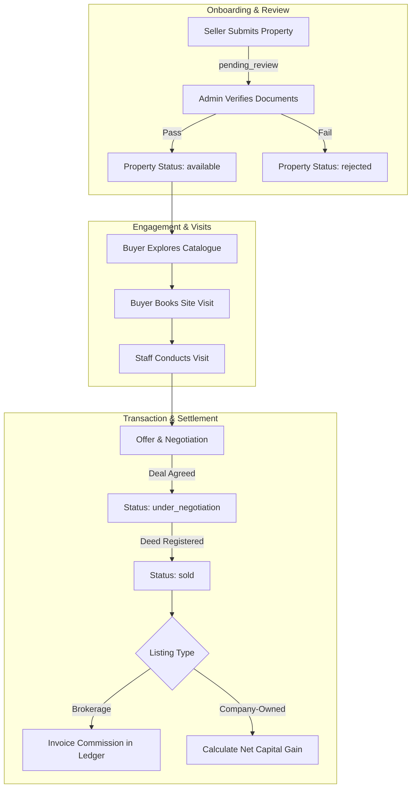

# MasterJiEstates — Business Workflows & Operational Processes

---

## 1. Overview & Standard Workflow Specification

This document codifies the seventeen (17) end-to-end business and operational workflows powering MasterJiEstates. Each workflow specifies:
- **Trigger & Starting Role**
- **Required Inputs & Validations**
- **Sequential Execution Steps**
- **Backend Responsibilities**
- **Database Collections Involved**
- **Security & Authorization Gates**
- **Expected Outcome**
- **Failure Modes & Edge Cases**

---

## 2. Authentication & User Lifecycle Workflows

### WF-01: User Registration
- **Starting Role:** Public Visitor
- **Required Inputs:** Full Name, Valid Email Address, 10-digit Indian Mobile Number, Password ($\ge 8$ chars, 1 uppercase, 1 number, 1 special char).
- **Sequential Steps:**
  1. Visitor navigates to `/register` (split-screen layout).
  2. Visitor completes registration form and clicks "Create Account".
  3. Frontend executes client-side schema validation (Zod/Yup).
  4. Client dispatches `POST /api/v1/auth/register`.
  5. Backend checks for unique email and unique phone in `users` collection.
  6. Backend hashes password using bcrypt (12 salt rounds).
  7. Backend creates user record with hardcoded `role: 'user'`.
  8. Backend signs a JWT (containing `userId` and `role`) and attaches it to an `HttpOnly`, `Secure`, `SameSite=Lax` cookie.
  9. Backend returns sanitized user DTO (`_id`, `name`, `email`, `phone`, `role`).
  10. Frontend stores user state in React AuthContext and redirects to `/dashboard`.
- **Database Collections:** `users`
- **Security Gates:** Rate-limited to 5 registrations/hour/IP; role tampering strictly ignored; password never stored in plaintext.
- **Failure & Edge Cases:**
  - *Email/Phone already exists:* Return `409 Conflict` with clear user-friendly message.
  - *Weak password:* Return `422 Unprocessable Entity` with specific constraint feedback.

---

### WF-02: User Login & Session Termination (Logout)
- **Starting Role:** Registered User / Administrator
- **Required Inputs:** Email Address, Password, optional `rememberMe` checkbox.
- **Sequential Steps:**
  1. User navigates to `/login`.
  2. Submits email and password.
  3. Client dispatches `POST /api/v1/auth/login`.
  4. Backend retrieves user record including `password` hash (`select('+password')`).
  5. If user not found or `isSuspended === true`, reject login.
  6. Backend compares password using `bcrypt.compare()`.
  7. Upon success, signs JWT with expiration (1 day for regular, 7 days if `rememberMe`).
  8. Sets HTTP-only cookie `mje_token`.
  9. Returns user profile DTO.
  10. For Logout: Client triggers `POST /api/v1/auth/logout`. Backend clears `mje_token` cookie with expired `Set-Cookie` header. Client resets AuthContext.
- **Database Collections:** `users`
- **Security Gates:** Rate-limited to 5 failed attempts per 15 minutes per IP; generic error "Invalid email or password" returned to prevent user enumeration.
- **Failure & Edge Cases:**
  - *Account suspended:* Return `403 Forbidden` with notification to contact support.
  - *Expired cookie on protected page:* Frontend interceptor catches `401 Unauthorized` and smoothly redirects to `/login?redirect=...`.

---

### WF-03: Password Reset via Secure Email Token
- **Starting Role:** Public Visitor / Registered User
- **Required Inputs:** Registered Email Address.
- **Sequential Steps:**
  1. User clicks "Forgot Password" on `/login` and enters registered email.
  2. Client dispatches `POST /api/v1/auth/forgot-password`.
  3. Backend checks if email exists in `users`. If not, returns generic success response to prevent enumeration.
  4. If user exists, backend generates a cryptographically random 32-byte hex token.
  5. Backend hashes the token with SHA-256 and stores `resetPasswordToken` and `resetPasswordExpires` (set to `Date.now() + 30 * 60 * 1000`, 30 minutes) on the user document.
  6. Backend dispatches transactional email with reset link `https://masterjiestates.in/reset-password/{unhashedToken}`.
  7. User clicks link, enters new password on frontend.
  8. Client sends `PATCH /api/v1/auth/reset-password/:token` with new password.
  9. Backend hashes input token with SHA-256, queries database for matching unexpired token.
  10. If valid, updates password with bcrypt, clears reset fields, invalidates existing tokens, and sets new session cookie.
- **Database Collections:** `users`
- **Security Gates:** Token expires in 30 minutes; single-use token invalidated immediately upon consumption.

---

## 3. Buyer Discovery & Engagement Workflows

### WF-04: Property Discovery, Search & Filtering
- **Starting Role:** Public Visitor / Registered User
- **Required Inputs:** Search filters: City, Locality, Category, Budget Min/Max, BHK count, Listing Type (`brokerage` / `company_owned`).
- **Sequential Steps:**
  1. User accesses `/properties` or submits search query from homepage hero.
  2. Client constructs query parameters (e.g., `?city=gurugram&category=apartments&minPrice=5000000&maxPrice=15000000&bhk=3&sort=price_asc&page=1`).
  3. Client dispatches `GET /api/v1/properties?...`.
  4. Backend sanitizes query params, enforces baseline query: `{ status: { $in: ['available', 'under_negotiation'] } }`.
  5. Executes query against compound indexed collection with cursor-based or offset pagination (`limit: 12`).
  6. Returns array of public property cards and pagination metadata (`currentPage`, `totalPages`, `totalCount`).
  7. Client renders property cards with appropriate visual badge (`MasterJi Direct` vs `Verified Brokerage`).
- **Database Collections:** `properties`
- **Security Gates:** Public query projections explicitly omit `ownerId`, `internalNotes`, `documents`, and any internal valuation fields.

---

### WF-05: Property Favouriting (Bookmark)
- **Starting Role:** Registered User
- **Required Inputs:** `propertyId`.
- **Sequential Steps:**
  1. Authenticated user clicks heart icon on property card or property detail page.
  2. Client dispatches `POST /api/v1/favourites/toggle` with `{ propertyId }`.
  3. Backend checks `favourites` collection for `{ userId: req.user._id, propertyId }`.
  4. If record exists: deletes document (unfavourite), returns `{ isFavourited: false }`.
  5. If record does not exist: creates new document, returns `{ isFavourited: true }`.
  6. Frontend updates heart icon state optimistically.
- **Database Collections:** `favourites`, `properties`
- **Security Gates:** Requires active authenticated session. Non-authenticated clicks trigger login prompt drawer.

---

### WF-06: Property Enquiry Submission (Lead Generation)
- **Starting Role:** Public Visitor / Registered User
- **Required Inputs:** `propertyId`, Name, Mobile Number, Email, Optional Message.
- **Sequential Steps:**
  1. User views property details at `/properties/.../:slugId`.
  2. User fills out enquiry modal or sidebar form. (If logged in, name/phone/email are pre-populated).
  3. Client dispatches `POST /api/v1/enquiries`.
  4. Backend validates phone format (+91 10-digits) and message length.
  5. Creates record in `enquiries` collection with `status: 'new'`.
  6. In-app notification created for administrative dashboard.
  7. Backend returns success message: "Your enquiry has been received. A MasterJiEstates property advisor will contact you within 24 hours."
- **Database Collections:** `enquiries`, `notifications`
- **Security Gates:** Rate-limited to 5 enquiries/hour/IP to prevent competitor bot scraping and SMS flooding.

---

### WF-07: Escorted Site Visit Booking & Lifecycle
- **Starting Role:** Registered User (Buyer)
- **Required Inputs:** `propertyId`, Preferred Visit Date ($\ge 24\text{ hours}$ in advance), Preferred Time Slot (`morning`, `afternoon`, `evening`), Notes.
- **Sequential Steps:**
  1. User clicks "Schedule Site Visit" on property detail page.
  2. Selects date from datepicker and chooses time slot.
  3. Submits `POST /api/v1/site-visits`.
  4. Backend verifies date constraint, creates document in `siteVisits` with `status: 'requested'`.
  5. Admin/Staff receives notification in Admin Portal.
  6. Operations team calls buyer, confirms logistical details, assigns field executive, and updates status to `confirmed`.
  7. Buyer receives in-app alert and confirmation email.
  8. Field executive conducts physical walkthrough with buyer.
  9. Staff updates status to `completed` and logs buyer interest level (`high`, `moderate`, `not_interested`, `offer_made`).
- **Database Collections:** `siteVisits`, `properties`, `users`, `notifications`
- **Security Gates:** Users can only view and cancel their own scheduled visits.

---

## 4. Seller & Property Onboarding Workflows

### WF-08: Seller Property Submission
- **Starting Role:** Registered User (Seller)
- **Required Inputs:** Title, Description, Category, Target Price, Complete Address, City, Locality, Area in Sq Ft, Category-specific specs (BHK, floors, facing, etc.), Amenities list, 3 to 15 property photos.
- **Sequential Steps:**
  1. User accesses `/dashboard/properties/new`.
  2. Step 1: Basic Information & Category Selection.
  3. Step 2: Location details (City, Locality, Landmark, Street address).
  4. Step 3: Category Specifications (Dynamic form fields based on category selected).
  5. Step 4: Amenities selection (Water supply, power backup, parking, security, etc.).
  6. Step 5: Photo uploads (Direct stream or signed upload to Cloudinary; client compresses images; watermarking applied).
  7. Step 6: Review & Brokerage terms agreement check.
  8. User clicks "Submit for Review".
  9. Client sends `POST /api/v1/user/properties`.
  10. Backend enforces `listingType: 'brokerage'`, `ownerId: req.user._id`, and `status: 'pending_review'`.
  11. Property saved; notification dispatched to Admin moderation queue.
- **Database Collections:** `properties`, `users`, `notifications`, `auditLogs`
- **Security Gates:** Owner cannot self-publish to `available`. Private ownership is stamped from JWT `req.user._id`.

---

### WF-09: Admin Property Moderation (Approval)
- **Starting Role:** Administrator
- **Required Inputs:** `propertyId`, verification notes.
- **Sequential Steps:**
  1. Admin opens `/admin/approvals`.
  2. Selects property in `pending_review` status.
  3. Reviews uploaded imagery, address validity, pricing reasonableness, and owner contact.
  4. Admin verifies legal authorization/written mandate.
  5. Clicks "Approve & Publish".
  6. Client dispatches `PATCH /api/v1/admin/properties/:id/approve`.
  7. Backend transitions status to `approved`, then automatically `available`.
  8. Generates unique SEO slug and updates index.
  9. Dispatches notification to property owner: "Your property has been approved and is now live on MasterJiEstates."
  10. System creates immutable log in `auditLogs`.
- **Database Collections:** `properties`, `notifications`, `auditLogs`
- **Security Gates:** Strictly gated by `verifyAdmin` middleware.

---

### WF-10: Admin Property Rejection & Resubmission
- **Starting Role:** Administrator (Rejection) / Registered User (Resubmission)
- **Required Inputs:** Rejection reason categories (e.g., "Inadequate photographs", "Unrealistic pricing", "Incomplete ownership proof", "Duplicate listing") and detailed remarks.
- **Sequential Steps:**
  1. Admin selects property in moderation queue and clicks "Reject Listing".
  2. Enters structured feedback remarks and confirms.
  3. Client dispatches `PATCH /api/v1/admin/properties/:id/reject` with `{ reason }`.
  4. Backend transitions status to `rejected`, stores `rejectionReason`.
  5. Notification sent to owner's dashboard.
  6. Owner reviews remarks under `/dashboard/properties`, clicks "Edit & Resubmit".
  7. Owner updates required information/photos and submits.
  8. Status transitions back to `pending_review`.
- **Database Collections:** `properties`, `notifications`, `auditLogs`

---

## 5. Transaction & Financial Workflows

### WF-11: Brokerage Transaction & Deal Execution
- **Starting Role:** Administrator / Operations Lead
- **Required Inputs:** `propertyId`, `buyerId` (or buyer contact details), `finalAgreedPrice`, `dealDate`, `commissionRatePercent`.
- **Sequential Steps:**
  1. MasterJiEstates field team mediates buyer-seller price negotiations.
  2. Verbal agreement reached; earnest token paid by buyer.
  3. Admin updates property status to `under_negotiation`.
  4. Legal team coordinates sale deed registration.
  5. Once sale deed is registered, Admin accesses `/admin/deals/new`.
  6. Admin creates deal record:
     - Calculates expected commission: $\text{Commission} = \text{Agreed Price} \times \left(\frac{\text{Commission Rate}}{100}\right)$.
  7. Property status transitioned to `sold`.
  8. Deal record created in `deals` collection; corresponding pending invoice created in `commissions` collection.
  9. Both buyer and seller receive completion notifications.
- **Database Collections:** `deals`, `commissions`, `properties`, `auditLogs`
- **Security Gates:** Financial records strictly restricted to super-administrators.

---

### WF-12: Company-Owned Property Acquisition (Asset Intake)
- **Starting Role:** Administrator / Investment Committee
- **Required Inputs:** Title, Category, Complete Address, Base Purchase Price, Registration & Stamp Duty Expenses, Legal Clearance Fees, Seller Credentials, Title Clearance Report URL.
- **Sequential Steps:**
  1. MasterJiEstates executes direct purchase agreement with an external property seller.
  2. Legal counsel completes 30-year title search and encumbrance verification.
  3. Sale deed registered in the corporate name of MasterJiEstates.
  4. Admin accesses `/admin/company-inventory/new`.
  5. Submits complete property asset record with `listingType: 'company_owned'`.
  6. Backend creates property record with `status: 'draft'` or `available`.
  7. Simultaneously logs acquisition transaction in `purchases` collection:
     - `purchasePrice`, `stampDuty`, `legalFees`, `acquisitionDate`, `sellerDetails`.
  8. Establishes initial total cost basis: $\text{Cost Basis} = \text{Purchase Price} + \text{Stamp Duty} + \text{Legal Fees}$.
- **Database Collections:** `properties`, `purchases`, `auditLogs`
- **Security Gates:** `purchases` collection is isolated from public property models.

---

### WF-13: Company-Owned Property Resale & Net Profit Realization
- **Starting Role:** Administrator
- **Required Inputs:** `propertyId`, Buyer Details, Final Resale Price, Closing Date.
- **Sequential Steps:**
  1. Company-owned property is published on public catalogue with `MasterJi Direct` badge.
  2. Buyer submits direct purchase offer.
  3. Direct price negotiation conducted by MasterJi executive team.
  4. Agreement for sale executed; sale deed registered to buyer.
  5. Admin navigates to `/admin/company-inventory/:id/close-sale`.
  6. Enters final sale closing price and deed execution details.
  7. Backend aggregates:
     - Initial Acquisition Cost Basis from `purchases`.
     - Sum of all itemized CapEx from `expenses` attached to this `propertyId`.
     - $\text{Total Investment} = \text{Cost Basis} + \sum \text{CapEx}$.
     - $\text{Net Profit} = \text{Final Sale Price} - \text{Total Investment}$.
     - $\text{ROI \%} = \left(\frac{\text{Net Profit}}{\text{Total Investment}}\right) \times 100$.
  8. Updates property status to `sold`.
  9. Records final closing record in `deals` with `dealType: 'company_owned_sale'`.
- **Database Collections:** `properties`, `purchases`, `expenses`, `deals`, `auditLogs`
- **Security Gates:** Profit figures and CapEx calculations are restricted exclusively to super-admin analytics.

---

### WF-14: Commission Tracking & Settlement Ledger
- **Starting Role:** Administrator
- **Required Inputs:** `dealId`, `paymentAmountReceived`, `paymentMode` (NEFT/RTGS/Cheque), `transactionReference`, `settlementDate`.
- **Sequential Steps:**
  1. Client/Owner pays brokerage fee to MasterJiEstates bank account.
  2. Admin navigates to `/admin/deals` and selects pending commission entry.
  3. Enters payment receipt details.
  4. Backend increments `receivedAmount` on `commissions` document.
  5. If `receivedAmount >= calculatedAmount`, updates `paymentStatus: 'settled'`. If partial, updates to `partial`.
  6. System generates printable GST-compliant brokerage receipt/invoice voucher.
- **Database Collections:** `commissions`, `deals`, `auditLogs`

---

### WF-15: Itemized CapEx & Holding Expense Logging
- **Starting Role:** Administrator
- **Required Inputs:** `propertyId` (Company-owned), `expenseType` (`renovation`, `legal`, `painting`, `maintenance`, `marketing`, `security`), `amount`, `date`, `vendorName`, `receiptUrl`, `notes`.
- **Sequential Steps:**
  1. Operations incurs repair or enhancement cost on an acquired asset.
  2. Admin navigates to `/admin/financials/expenses/new`.
  3. Uploads receipt/invoice to Cloudinary.
  4. Submits expense entry.
  5. Backend creates document in `expenses` collection linking to `propertyId`.
  6. Recalculates total running cost basis for the asset in business reports.
- **Database Collections:** `expenses`, `properties`

---

### WF-16: System Notifications & Alert Dispatch
- **Starting Role:** Automated System Trigger / Admin
- **Required Inputs:** Target `userId`, Notification Title, Message, Category, Target Route Link.
- **Sequential Steps:**
  1. A milestone event occurs (e.g., Property Approved, Site Visit Confirmed, Lead Received).
  2. System notification helper creates document in `notifications` collection with `isRead: false`.
  3. Real-time badge counter increments on user or admin dashboard header.
  4. If email service is configured, dispatches transactional notification asynchronously.
  5. User views notification drawer and clicks notification; item marked `isRead: true` and user navigated to relevant link.
- **Database Collections:** `notifications`

---

### WF-17: Comprehensive Workflow Summary Matrix

