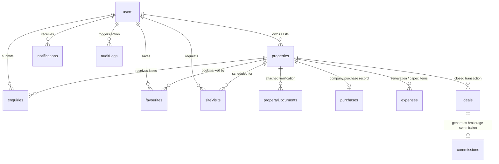

# MasterJiEstates — Database Schema & Data Modeling Plan

---

## 1. Entity-Relationship Architecture (ERD)

---

## 2. Comprehensive Collection Specifications

### 2.1 Collection: `users`
- **Purpose:** Central repository for authentication, user profiles, unified buyer/seller state, and RBAC roles.

| Field Name | BSON Type | Required | Default | Indexes / Validation | Purpose & Privacy Rules |
| :--- | :--- | :---: | :---: | :--- | :--- |
| `_id` | ObjectId | Yes | Auto | Primary Key | Unique document identifier. |
| `name` | String | Yes | — | Min 2, Max 100 chars, trimmed | Full name of registered user. |
| `email` | String | Yes | — | Unique, lowercase, valid email | Primary login handle. Never exposed publicly. |
| `password` | String | Yes | — | `select: false`, hashed | Bcrypt hashed password. Stripped from all queries. |
| `phone` | String | Yes | — | Unique, regex `^[6-9]\d{9}$` | 10-digit Indian mobile number. Private PII. |
| `role` | String | Yes | `'user'` | Enum: `['user', 'staff', 'admin']` | RBAC role. Protected against client mutation. |
| `isEmailVerified` | Boolean | Yes | `false` | — | Email verification status flag. |
| `isPhoneVerified` | Boolean | Yes | `false` | — | SMS OTP verification flag. |
| `isSuspended` | Boolean | Yes | `false` | Index | Administrative ban toggle. |
| `resetPasswordToken`| String | No | — | `select: false` | SHA-256 hashed password reset token. |
| `resetPasswordExpires`| Date | No | — | `select: false` | Expiration timestamp for reset token. |
| `preferences` | Object | No | `{}` | — | Communication, budget, and notification prefs. |
| `createdAt` | Date | Yes | `Date.now` | Index (DESC) | Record creation timestamp. |
| `updatedAt` | Date | Yes | `Date.now` | — | Last modification timestamp. |

---

### 2.2 Collection: `properties`
- **Purpose:** Primary repository for all real estate inventory (both brokerage and company-owned).

| Field Name | BSON Type | Required | Default | Indexes / Validation | Purpose & Privacy Rules |
| :--- | :--- | :---: | :---: | :--- | :--- |
| `_id` | ObjectId | Yes | Auto | Primary Key | Unique document identifier. |
| `title` | String | Yes | — | Min 10, Max 160 chars, Text Index | Catchy listing title (e.g., "Luxury 3 BHK Penthouse"). |
| `slug` | String | Yes | — | Unique Index, lowercase | SEO canonical slug (`/properties/.../:slug`). |
| `description` | String | Yes | — | Min 50, Max 4000 chars, Text Index | Detailed description of specifications and layout. |
| `category` | String | Yes | — | Index, Enum: `['independent_house', 'apartment', 'villa', 'residential_plot', 'commercial_property', 'commercial_building', 'other']` | Primary property category. |
| `listingType` | String | Yes | `'brokerage'`| Index, Enum: `['brokerage', 'company_owned']` | Critical business model differentiator. |
| `price` | Number | Yes | — | Index, Min: 10,000 | Publicly advertised asking price in INR. |
| `priceNegotiable`| Boolean | Yes | `true` | — | Flag indicating whether price is flexible. |
| `city` | String | Yes | — | Index, lowercase, trimmed | City (e.g., Gurugram, Delhi, Noida). |
| `locality` | String | Yes | — | Index, Text Index, trimmed | Sector / Neighborhood (e.g., Golf Course Road). |
| `address` | String | Yes | — | `select: false` | Full street address. **Private PII (masked publicly)**. |
| `location` | Object | No | — | 2dsphere Geospatial Index | GeoJSON: `{ type: 'Point', coordinates: [lng, lat] }`. |
| `areaSqFt` | Number | Yes | — | Min: 50 | Total land/built-up area in square feet. |
| `bedrooms` | Number | No | — | Contextual (Residential) | Number of bedrooms (BHK). |
| `bathrooms` | Number | No | — | Contextual (Residential) | Number of bathrooms. |
| `totalFloors` | Number | No | — | — | Total floors in the structure. |
| `floorNumber` | Number | No | — | Contextual (Apartments) | Specific floor on which apartment is situated. |
| `plotDimensions`| String | No | — | Contextual (Plots) | Dimensions (e.g., "30 x 60 ft"). |
| `facing` | String | No | — | Enum: `['North', 'South', 'East', 'West', 'North-East', 'North-West', 'South-East', 'South-West']` | Vastu / Sun orientation. |
| `furnishing` | String | No | `'unfurnished'` | Enum: `['unfurnished', 'semi_furnished', 'fully_furnished']` | Furnishing condition. |
| `amenities` | Array[String]| Yes | `[]` | Index | Array of amenities (Power Backup, Security, Lift, etc.). |
| `images` | Array[Object]| Yes | `[]` | Min 1 photo required | Cloudinary image objects: `{ url, publicId, isPrimary }`. |
| `status` | String | Yes | `'pending_review'`| Index, Enum: `['draft', 'pending_review', 'approved', 'available', 'under_negotiation', 'sold', 'rejected', 'withdrawn']` | Property lifecycle state. |
| `rejectionReason`| String | No | — | — | Feedback to owner if listing rejected. |
| `ownerId` | ObjectId | No | — | Index, Ref: `users` | Submitting owner. Masked from public output. |
| `internalNotes` | String | No | — | `select: false` | Private notes for MasterJiEstates operations. |
| `isFeatured` | Boolean | Yes | `false` | Index | Flag for homepage carousel placement. |
| `createdAt` | Date | Yes | `Date.now` | Index (DESC) | Creation timestamp. |
| `updatedAt` | Date | Yes | `Date.now` | — | Last update timestamp. |

---

### 2.3 Collection: `enquiries`
- **Purpose:** Inbound lead records and customer inquiries for properties.

| Field Name | BSON Type | Required | Default | References / Indexes | Privacy & Business Logic |
| :--- | :--- | :---: | :---: | :--- | :--- |
| `_id` | ObjectId | Yes | Auto | Primary Key | Identifier. |
| `propertyId` | ObjectId | Yes | — | Ref: `properties`, Index | Target property. |
| `userId` | ObjectId | No | — | Ref: `users`, Index | Submitting user (null for guest enquiries). |
| `name` | String | Yes | — | Trimmed | Inquirer's full name. |
| `phone` | String | Yes | — | Regex `^[6-9]\d{9}$`, Index | Contact mobile. Visible to Admin/Staff only. |
| `email` | String | Yes | — | Valid email | Contact email. |
| `message` | String | Yes | — | Max 1000 chars | Customer inquiry text. |
| `status` | String | Yes | `'new'` | Enum: `['new', 'contacted', 'scheduled', 'qualified', 'lost', 'converted']` | Lead progression state. |
| `assignedTo` | ObjectId | No | — | Ref: `users` (Staff) | Assigned relationship manager. |
| `adminNotes` | Array[Object]| No | `[]` | `{ note, authorId, createdAt }` | Internal CRM log of interactions. |
| `createdAt` | Date | Yes | `Date.now` | Index (DESC) | Ingestion timestamp. |

---

### 2.4 Collection: `favourites`
- **Purpose:** User property bookmarking and saved lists.

| Field Name | BSON Type | Required | Indexes / Constraints | Business Rules |
| :--- | :--- | :---: | :--- | :--- |
| `_id` | ObjectId | Yes | Primary Key | Identifier. |
| `userId` | ObjectId | Yes | Ref: `users`, Index | Bookmarking user. |
| `propertyId` | ObjectId | Yes | Ref: `properties`, Index | Bookmarked property. |
| `createdAt` | Date | Yes | Default: `Date.now` | Timestamp. |

*Compound Unique Index:* `{ userId: 1, propertyId: 1 }` prevents duplicate favorites.

---

### 2.5 Collection: `siteVisits`
- **Purpose:** Scheduling, tracking, and recording outcomes of physical property tours.

| Field Name | BSON Type | Required | Default | Constraints / References |
| :--- | :--- | :---: | :---: | :--- |
| `_id` | ObjectId | Yes | Auto | Primary Key |
| `propertyId` | ObjectId | Yes | — | Ref: `properties`, Index |
| `userId` | ObjectId | Yes | — | Ref: `users`, Index (Buyer) |
| `preferredDate`| Date | Yes | — | Must be $\ge 24\text{ hours}$ in advance |
| `preferredTimeSlot`| String | Yes | — | Enum: `['morning', 'afternoon', 'evening']` |
| `status` | String | Yes | `'requested'` | Enum: `['requested', 'confirmed', 'rescheduled', 'completed', 'cancelled']` |
| `assignedStaffId`| ObjectId | No | — | Ref: `users` (Field Executive) |
| `visitorFeedback`| String | No | — | Customer comments post-visit |
| `executiveNotes` | String | No | — | Internal assessment of buyer purchase intent |
| `createdAt` | Date | Yes | `Date.now` | Creation timestamp |

---

### 2.6 Collection: `deals`
- **Purpose:** Legally finalized real estate transactions and deal room records.

| Field Name | BSON Type | Required | References / Constraints | Business Meaning |
| :--- | :--- | :---: | :--- | :--- |
| `_id` | ObjectId | Yes | Primary Key | Identifier. |
| `propertyId` | ObjectId | Yes | Ref: `properties`, Unique | Associated property asset. |
| `dealType` | String | Yes | Enum: `['brokerage_sale', 'company_owned_sale']` | Transaction structure. |
| `buyerId` | ObjectId | No | Ref: `users` | Buyer user record if registered. |
| `sellerId` | ObjectId | No | Ref: `users` | Seller user record (for brokerage). |
| `finalAgreedPrice`| Number | Yes | Min: 10,000 | Closing sale deed price in INR. |
| `dealDate` | Date | Yes | — | Registered date of deed execution. |
| `status` | String | Yes | Enum: `['pending_registry', 'completed', 'cancelled']` | Deal closing state. |
| `closingNotes` | String | No | — | Legal and administrative remarks. |
| `createdAt` | Date | Yes | `Date.now` | Transaction log timestamp. |

---

### 2.7 Collection: `commissions`
- **Purpose:** Brokerage fee ledger and settlement tracking for brokerage deals.

| Field Name | BSON Type | Required | References / Default | Financial Accounting Logic |
| :--- | :--- | :---: | :--- | :--- |
| `_id` | ObjectId | Yes | Primary Key | Identifier. |
| `dealId` | ObjectId | Yes | Ref: `deals`, Unique | Associated closed deal. |
| `propertyId` | ObjectId | Yes | Ref: `properties` | Target property asset. |
| `commissionRatePercent`| Number | Yes | Min: 0.1, Max: 10.0 | Agreed brokerage percentage (e.g., 1.5%). |
| `calculatedAmount` | Number | Yes | — | `finalAgreedPrice * (commissionRate / 100)`. |
| `receivedAmount` | Number | Yes | Default: `0` | Cumulative amount collected to date. |
| `paymentStatus` | String | Yes | Default: `'pending'` | Enum: `['pending', 'partial', 'settled']`. |
| `settlementDate` | Date | No | — | Date of final payment receipt. |
| `paymentHistory` | Array[Object]| No | `[]` | `{ amount, mode, referenceNo, receivedDate }`. |

---

### 2.8 Collection: `purchases`
- **Purpose:** Confidential acquisition cost ledger for **company-owned** properties. Strictly isolated from public models.

| Field Name | BSON Type | Required | Constraints / References | Confidentiality Level |
| :--- | :--- | :---: | :--- | :--- |
| `_id` | ObjectId | Yes | Primary Key | Primary Key. |
| `propertyId` | ObjectId | Yes | Ref: `properties`, Unique | Target company asset. |
| `acquisitionDate`| Date | Yes | — | Date of company purchase deed. |
| `purchasePrice` | Number | Yes | Min: 10,000 | Base purchase price paid by company. **TOP SECRET**. |
| `stampDutyFee` | Number | Yes | Min: 0 | Government stamp duty & registration fees paid. |
| `legalFees` | Number | Yes | Min: 0 | Title search, lawyer, and deed drafting fees. |
| `totalCostBasis`| Number | Yes | Computed | `purchasePrice + stampDutyFee + legalFees`. |
| `sellerDetails` | Object | Yes | `{ name, phone, pan, aadhaarRef }` | Prior owner credentials. |
| `titleReportUrl` | String | No | Cloudinary secure document URL | Legal title clearance certificate scan. |

---

### 2.9 Collection: `expenses`
- **Purpose:** Itemized capital expenditure (CapEx) and holding costs on **company-owned** properties.

| Field Name | BSON Type | Required | Constraints / References | Financial Calculation Role |
| :--- | :--- | :---: | :--- | :--- |
| `_id` | ObjectId | Yes | Primary Key | Identifier. |
| `propertyId` | ObjectId | Yes | Ref: `properties`, Index | Associated company asset. |
| `expenseType` | String | Yes | Enum: `['renovation', 'painting', 'legal', 'maintenance', 'fencing', 'marketing', 'security', 'other']` | Expense categorization. |
| `amount` | Number | Yes | Min: 1 | Incurred expense amount in INR. |
| `expenseDate` | Date | Yes | — | Date payment was disbursed. |
| `vendorName` | String | No | — | Contractor / Service provider. |
| `receiptUrl` | String | No | Secure Cloudinary URL | Scanned tax receipt / invoice. |
| `notes` | String | No | — | Description of work performed. |

---

### 2.10 Collection: `propertyDocuments`
- **Purpose:** Verification documents (Sale Deed copies, Khata, Tax receipts, Encumbrance Certificates) uploaded by owners or staff.

| Field Name | BSON Type | Required | Constraints / References | Security & Access Rule |
| :--- | :--- | :---: | :--- | :--- |
| `_id` | ObjectId | Yes | Primary Key | Identifier. |
| `propertyId` | ObjectId | Yes | Ref: `properties`, Index | Associated property. |
| `documentType` | String | Yes | Enum: `['sale_deed', 'property_tax_receipt', 'encumbrance_certificate', 'electricity_bill', 'owner_id', 'brokerage_mandate']` | Type of legal document. |
| `fileUrl` | String | Yes | Cloudinary authenticated URL | Uploaded PDF or image scan. |
| `verificationStatus`| String| Yes | Default: `'pending'` | Enum: `['pending', 'verified', 'rejected']`. |
| `verifiedBy` | ObjectId | No | Ref: `users` (Admin) | Admin who reviewed document. |
| `notes` | String | No | — | Legal notes on validity. |

---

### 2.11 Collection: `auditLogs`
- **Purpose:** Immutable audit trail of administrative mutations, approvals, price edits, and status changes.

| Field Name | BSON Type | Required | Constraints / References | Purpose |
| :--- | :--- | :---: | :--- | :--- |
| `_id` | ObjectId | Yes | Primary Key | Identifier. |
| `actorId` | ObjectId | Yes | Ref: `users`, Index | User or admin who performed the action. |
| `action` | String | Yes | Index | e.g., `PROPERTY_APPROVED`, `PROPERTY_REJECTED`, `PRICE_UPDATED`, `DEAL_CLOSED`. |
| `targetCollection`| String | Yes | — | e.g., `'properties'`, `'users'`, `'deals'`. |
| `targetId` | ObjectId | Yes | Index | Document ID that was altered. |
| `changes` | Object | No | `{ before: {}, after: {} }` | Delta diff of modified fields. |
| `ipAddress` | String | No | — | Client IP address. |
| `userAgent` | String | No | — | Browser / Client User-Agent string. |
| `timestamp` | Date | Yes | Default: `Date.now`, Index (DESC) | Immutable event timestamp. |

---

### 2.12 Collection: `websiteSettings`
- **Purpose:** Singleton document storing CMS content, promotional announcements, partner services, and contact metadata.

| Field Name | BSON Type | Purpose & Contents |
| :--- | :--- | :--- |
| `_id` | ObjectId | Single document instance identifier (`singleton: true`). |
| `companyInfo` | Object | Corporate name, tagline, address, primary helpline, WhatsApp number, support email. |
| `announcementBanner`| Object | `{ isActive: Boolean, text: String, linkUrl: String, bgColor: String }`. |
| `featuredPartners` | Array[Object]| Partner services listings (Home loans, Architecture, Interiors, Carpentry, Software) with disclaimers. |
| `testimonials` | Array[Object]| Client reviews: `{ clientName, clientRole, quote, photoUrl, rating }`. |
| `socialLinks` | Object | `{ facebook, instagram, linkedin, youtube, twitter }`. |
| `updatedAt` | Date | Timestamp of last CMS update. |

