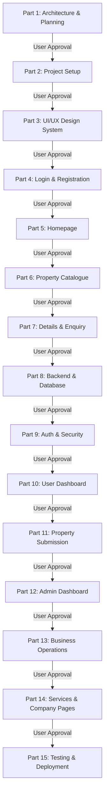

# MasterJiEstates — 15-Part Phased Development Roadmap

---

## 1. Roadmap Architecture & Execution Philosophy

The development of MasterJiEstates is structured as a sequential, 15-part engineering lifecycle. To guarantee security, stability, and adherence to business logic, **each phase must be reviewed, tested, and explicitly approved by the stakeholder before the subsequent phase commences.**

---

## 2. Phase-by-Phase Roadmap Specifications

### Part 1: Project Architecture, Business Analysis & Technical Blueprint *(Current Phase)*
- **Objective:** Establish the complete conceptual, business, architectural, database, API, and security foundation for MasterJiEstates.
- **Deliverables:**
  - Complete 15-document architectural suite in `/documentation`.
  - Comprehensive master `README.md`.
  - Executive review report and risk analysis.
- **Dependencies:** None.
- **Verification Gate:** Stakeholder reviews all documents and issues explicit approval. *Zero code or dependencies installed in this phase.*

---

### Part 2: Project Workspace & Scaffolding Setup
- **Objective:** Initialize the project directory, package manifests, build tools, and configuration baselines.
- **Deliverables:**
  - Frontend scaffolding via Vite (`client/`).
  - Backend Node.js/Express environment scaffolding (`server/`).
  - `.gitignore`, `.env.example` templates, ESLint, and Prettier configurations.
  - Verification of local development servers running concurrently.
- **Dependencies:** Part 1 approval.
- **Verification Gate:** Clean local build of both frontend and backend dev servers without dependency warnings.

---

### Part 3: Global UI/UX Design System & Styling Foundations
- **Objective:** Implement the design tokens, Neumorphic styles, Liquid Glass classes, Tailwind palette, and Material UI theme.
- **Deliverables:**
  - Tailwind CSS configuration (`tailwind.config.js`) extending Deep Navy and Gold tokens.
  - Custom Neumorphic shadow classes (`neumorphism.css`) and Liquid Glass modal utilities.
  - Material UI (MUI) theme configuration with Emotion cache prepending.
  - GSAP animation utilities and timeline helper functions.
  - Reusable component primitives (Buttons, Inputs, Badges, Modals, Card containers).
- **Dependencies:** Part 2.
- **Verification Gate:** Visual component showcase rendering design tokens, shadows, and interactive states accurately across mobile and desktop viewports.

---

### Part 4: Authentication & Registration System (Split-Screen UI)
- **Objective:** Construct the high-fidelity split-screen login, registration, and password recovery interfaces.
- **Deliverables:**
  - Split-screen layout (Left form, right architectural photograph with branding).
  - Login form with email, password show/hide toggle, and remember me.
  - Registration form with validation for name, email, 10-digit Indian phone, and password constraints.
  - Forgot password and reset password view components.
  - Client-side validation using Zod/Yup and responsive mobile stacking.
- **Dependencies:** Part 3.
- **Verification Gate:** Interactive form validation, accessible input states, responsive layout tests.

---

### Part 5: Homepage & Brand Landing Experience
- **Objective:** Build the public brand landing page showcasing search capabilities, value propositions, and services.
- **Deliverables:**
  - High-impact Hero Section with GSAP entrance animation and multi-facet quick search bar.
  - "Why MasterJiEstates" value proposition cards (Zero PII leaks, 100% verified titles).
  - Featured properties carousel with dynamic "MasterJi Direct" vs "Brokerage" badges.
  - Supporting home services showcase (Home loans, Architecture, Interiors, Carpentry).
  - Testimonial slider, corporate statistics counter, and comprehensive responsive footer.
- **Dependencies:** Part 3, Part 4.
- **Verification Gate:** Smooth GSAP animation triggers, responsive mobile navbar drawer, functional search redirection.

---

### Part 6: Property Catalogue & Discovery Engine
- **Objective:** Build the master property catalogue with faceted filtering, multi-criteria sorting, and pagination.
- **Deliverables:**
  - Desktop sticky filter sidebar and mobile filter bottom-drawer.
  - Filter controls: City, Locality, Property Category, Budget Slider (INR Lakhs/Crores), BHK selector, Listing Type toggle.
  - Property grid view and list view switcher.
  - Property cards with high-resolution thumbnail, specs strip (BHK, sq ft, bathrooms), price tag, and quick-action heart icon.
  - Sorting dropdown (Newest, Price Low-High, Price High-Low) and pagination controls.
- **Dependencies:** Part 3, Part 5.
- **Verification Gate:** Instant filter state updates, URL query parameter synchronization, responsive card layout.

---

### Part 7: Property Details View & Lead Enquiry Modals
- **Objective:** Construct the comprehensive property detail landing page and lead capture components.
- **Deliverables:**
  - Multi-image gallery with thumbnail carousel and fullscreen lightbox.
  - Property overview header with price, locality, category badge, and share action.
  - Detailed specifications grid (carpet area, facing, floor, furnishing, age).
  - Categorized amenities icons grid (power backup, security, parking, clubhouse).
  - Map location preview placeholder and neighborhood highlights.
  - Sticky MasterJiEstates contact helpline card with "Submit Enquiry" and "Schedule Site Visit" modals.
- **Dependencies:** Part 6.
- **Verification Gate:** Modals open with Liquid Glass backdrop; form fields validate user contact inputs; owner details are completely hidden.

---

### Part 8: Backend REST API & Database Foundation
- **Objective:** Implement the Express server, MongoDB Atlas connection, and Mongoose schemas.
- **Deliverables:**
  - Mongoose models: `User`, `Property`, `Enquiry`, `Favourite`, `SiteVisit`, `Deal`, `Commission`, `Purchase`, `Expense`, `PropertyDocument`, `AuditLog`, `WebsiteSetting`.
  - Database connection pool configuration and error handling.
  - MongoDB compound and text search indexes.
  - Mock seed script populating 20 illustrative properties with AI-demo attribution flags.
  - Basic CRUD routes for properties with public DTO projections.
- **Dependencies:** Part 2.
- **Verification Gate:** Successful database connection, schema validation passes, seed script runs cleanly.

---

### Part 9: Secure Authentication, Session & Authorization Engine
- **Objective:** Implement bcrypt password hashing, JWT generation, secure cookie sessions, and RBAC middleware.
- **Deliverables:**
  - Auth controllers: `/api/v1/auth/register`, `/login`, `/logout`, `/me`.
  - Passwords hashed with bcrypt (12 rounds).
  - Tokens transmitted exclusively via `HttpOnly`, `Secure`, `SameSite=Lax` cookies.
  - `authenticate` middleware, `authorize` role guard, and `verifyOwnership` ABAC guard.
  - Multi-tier rate limiters on auth and enquiry endpoints.
  - Helmet and strict CORS configurations.
  - Secure CLI admin bootstrapping script (`seedAdmin.js`).
- **Dependencies:** Part 8.
- **Verification Gate:** Postman/curl tests confirming cookie issuance, role protection on admin routes, and rate-limiting triggers.

---

### Part 10: Unified User Dashboard (Buyer & Seller Portal)
- **Objective:** Construct the Neumorphic user portal supporting both buyer and seller activities within a single account.
- **Deliverables:**
  - Neumorphic dashboard layout with left navigation sidebar and tactile card surfaces.
  - Dashboard Overview: Key metric tiles, recent activity feed.
  - "My Favourites": Bookmarked properties grid with remove/enquire actions.
  - "My Enquiries": Real-time status tracker for submitted property inquiries.
  - "Site Visits": Scheduled visit dates, status pills, and cancellation controls.
  - "My Properties": Seller inventory with status badges (`pending_review`, `approved`, etc.).
  - Profile & Security: Update contact information and change password.
- **Dependencies:** Part 3, Part 9.
- **Verification Gate:** Seamless switching between buyer and seller views in the same account; live API data integration.

---

### Part 11: Multi-Step Property Submission System (Seller Wizard)
- **Objective:** Build the multi-step property submission wizard for external owners with Cloudinary media integration.
- **Deliverables:**
  - Step 1: Basic Information (Title, Description, Category, Target Price).
  - Step 2: Location Details (City, Locality, Landmark, Street address).
  - Step 3: Dynamic Category Specifications (BHK, floors, plot dimensions based on category).
  - Step 4: Amenities Multi-Select Matrix.
  - Step 5: Cloudinary photo uploader (drag & drop, client compression, preview thumbnails, primary photo selection).
  - Step 6: Brokerage mandate agreement check & submission.
  - Backend integration: Listing created with `status: 'pending_review'` and assigned `ownerId: req.user._id`.
- **Dependencies:** Part 8, Part 9, Part 10.
- **Verification Gate:** Multi-step validation, photo uploads to Cloudinary with watermarking, submission lands in admin review queue.

---

### Part 12: Administrative Back-Office Portal (Moderation & CMS)
- **Objective:** Construct the privileged administrative suite for listing moderation, lead management, and content control.
- **Deliverables:**
  - Admin Overview with platform metrics (Total listings, pending approvals, active leads, revenue).
  - Moderation Queue: Side-by-side inspection of submitted details, photos, and owner contact.
  - Approval and Rejection actions with structured feedback remarks.
  - Lead CRM Inbox: Customer enquiry tracking, staff assignment, and disposition updates.
  - Site Visit Dispatch Manager: Calendar schedule and field executive assignment.
  - Content Management System (CMS): Update promotional banners, testimonials, and contact helpline.
- **Dependencies:** Part 9, Part 11.
- **Verification Gate:** Strict server-side `verifyAdmin` enforcement; state transitions reflect instantly across the public site.

---

### Part 13: Business Operations & Financial Ledgers
- **Objective:** Implement the deal room, brokerage commission ledger, and company-owned property CapEx/profit tracker.
- **Deliverables:**
  - Closed Deal Room: Record sale transactions and executed deed values.
  - Brokerage Commission Ledger: Automated calculation based on agreed percentage, invoice generation, payment receipt logging, and settlement status.
  - Company Portfolio Financials: Private onboarding of company assets, logging purchase price, stamp duty, and legal fees.
  - CapEx & Expense Tracker: Itemized logging of repair, renovation, and holding expenses.
  - Net Profit & ROI Engine: Automated calculation (`Sale Price - Total Cost Basis`).
  - Executive Financial Analytics: Margin breakdowns and revenue trends.
- **Dependencies:** Part 12.
- **Verification Gate:** Financial ledgers strictly hidden from non-admin users; calculation formulas verified against edge cases.

---

### Part 14: Additional Services, Company Pages & Legal Disclaimers
- **Objective:** Build the About Us page, Contact Us page, dedicated Service detail pages, and statutory legal disclosures.
- **Deliverables:**
  - About Us: MasterJiEstates founding story, mission, operational principles, leadership team.
  - Services Hub: Detailed cards for Home Loan Assistance, Architectural Planning, Turnkey Interiors, and Carpentry.
  - Statutory Disclaimers: Prominent partner disclaimers stating services are delivered via certified third-party affiliates.
  - Contact Us: Head office address, interactive map coordinates, corporate helpline, inquiry form.
  - Legal: Terms & Conditions (Brokerage terms, liability) and Privacy Policy (DPDP compliance).
- **Dependencies:** Part 5, Part 7.
- **Verification Gate:** Clear disclaimers visible; contact form creates lead in admin CRM; responsive formatting.

---

### Part 15: End-to-End Testing, Optimization & Production Deployment
- **Objective:** Conduct security audits, Core Web Vitals optimization, and deploy the platform to production hosting.
- **Deliverables:**
  - End-to-end integration testing across buyer, seller, and admin lifecycles.
  - Performance audit: Image optimization, bundle minification, Core Web Vitals compliance.
  - Security audit: OWASP Top 10 verification, IDOR penetration testing, cookie verification.
  - Deployment configuration: Cloudflare Pages (Frontend) and Render (Backend).
  - Custom domain routing: `masterjiestates.in`, `www.masterjiestates.in`, and `api.masterjiestates.in`.
  - Production environment checklist and operational runbook.
- **Dependencies:** Parts 1 through 14.
- **Verification Gate:** Successful SSL handshake, live end-to-end user journey, 0 critical security vulnerabilities.

---

## 3. Strict Phasing Rule

> [!IMPORTANT]
> **Execution Constraint:** Under no circumstances will development automatically transition between phases. Following the delivery of each phase, a formal review report must be submitted, and the agent must wait for the user's explicit written approval before commencing the subsequent part.

