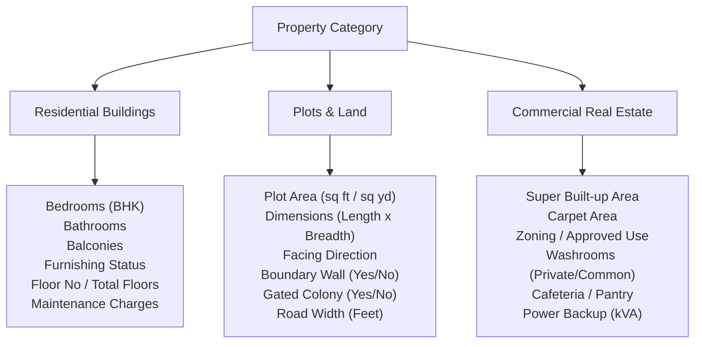
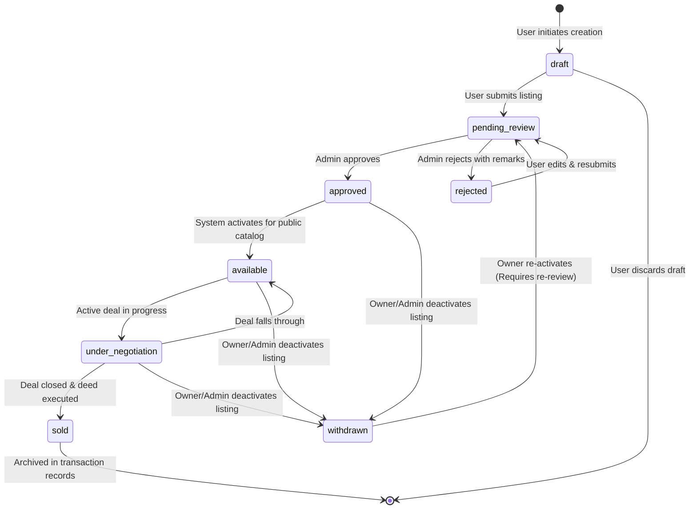

# MasterJiEstates — Functional Requirements Document (FRD)

---

## 1. System Users & Personas Overview

The platform supports three distinct functional personas:
1. **Public Visitor:** Unauthenticated guest browsing public listings, content, and submitting initial queries.
2. **Registered User (Unified Buyer & Seller):** Authenticated citizen account capable of both purchasing activities (saving favorites, booking site visits, enquiring) and selling activities (listing properties, tracking approvals).
3. **Administrator:** Privileged operator with access to the protected back-office dashboard, moderation queues, financial ledgers, and operational controls.

---

## 2. Public Visitor Capabilities

| Feature ID | Functional Requirement | Description | Business Rule / Acceptance Criteria |
| :--- | :--- | :--- | :--- |
| **PUB-01** | Homepage Discovery | Access responsive homepage with hero search, curated featured listings, value propositions, and services. | Must load with LCP < 2.5s; all CTA buttons functional. |
| **PUB-02** | Catalogue Browsing | Browse complete public catalogue with grid/list toggle, responsive cards, and dynamic badges. | Only properties with status `available` or `under_negotiation` appear. |
| **PUB-03** | Faceted Search & Filtering | Filter by: City, Locality, Property Category, Budget (Min/Max), Listing Type (`brokerage`/`company_owned`), and Bedrooms (BHK). | Filters update in real-time or via apply button; URL query parameters sync with filter state. |
| **PUB-04** | Sorting & Pagination | Sort by: Newest, Price (Low to High), Price (High to Low). Pagination with page numbers and items per page limit (default 12). | Page state persists in query string; smooth scroll to top on page change. |
| **PUB-05** | Property Detail View | View high-resolution image carousel, pricing, specifications, amenities grid, map preview, and MasterJiEstates contact badge. | Owner contact information and internal financial data are strictly excluded from output. |
| **PUB-06** | Public Lead Enquiry | Submit general enquiry or property-specific contact request via simple form (Name, Phone, Email, Message). | Captures lead into CRM queue; triggers rate limit (max 5 submissions/hour/IP) to prevent spam. |
| **PUB-07** | Company & Legal Pages | Access About Us, Services, Privacy Policy, and Terms & Conditions. | Static or CMS-managed text with clear disclaimers regarding partner services. |

---

## 3. Registered User Capabilities (Unified Account)

A single registered account seamlessly provides both Buyer and Seller capabilities without requiring multiple logins.

### 3.1 Buyer Capabilities

| Feature ID | Functional Requirement | Description | Business Rule / Acceptance Criteria |
| :--- | :--- | :--- | :--- |
| **BUY-01** | Favourites Management | Save/bookmark any property with a single click (heart icon); view all saved properties in user dashboard. | Real-time toggle; prevents duplicate entries; persists in `favourites` collection. |
| **BUY-02** | Enquiry Submission | Submit direct enquiry for a property directly from the details page or catalogue. | Automatically populates user profile details (name, email, phone); creates record in `enquiries`. |
| **BUY-03** | Site Visit Booking | Request an escorted physical site visit with preferred date and time slot (Morning, Afternoon, Evening). | System enforces preferred date to be at least 24 hours in the future; notifies ops team. |
| **BUY-04** | Enquiry & Visit Tracking | Monitor status of all submitted enquiries (`pending`, `contacted`, `scheduled`, `completed`, `closed`). | Real-time status badges in User Dashboard; shows MasterJi executive notes where applicable. |
| **BUY-05** | Recently Viewed History | Track last 10 viewed properties in dashboard. | Local storage backed with authenticated profile sync. |

### 3.2 Seller Capabilities

| Feature ID | Functional Requirement | Description | Business Rule / Acceptance Criteria |
| :--- | :--- | :--- | :--- |
| **SEL-01** | Multi-Step Property Submission | Multi-stage wizard to submit a property: Basic Info, Location, Category Specs, Amenities, Photographs, Legal Verification docs. | Dynamic form validation based on category; allows draft saving. |
| **SEL-02** | Media Upload & Gallery | Upload up to 15 high-resolution photographs per property. | Client-side compression; Cloudinary upload; automatic watermark overlay. |
| **SEL-03** | Submission Tracking | Dashboard view of all properties submitted by the user with real-time status badges. | Tracks statuses: `draft`, `pending_review`, `approved`, `rejected`, `withdrawn`. |
| **SEL-04** | Listing Editing & Re-submission | Edit details of a property in `draft` or `rejected` status. | If an `approved` property is edited, its status automatically reverts to `pending_review` for re-moderation. |
| **SEL-05** | Listing Withdrawal | Mark an active or pending listing as `withdrawn`. | Disables public visibility immediately; logs reason for withdrawal. |

---

## 4. Administrator Capabilities (Back-Office Portal)

Access to the admin interface (`/admin`) is guarded by strict server-side role validation.

| Feature ID | Functional Requirement | Description | Business Rule / Acceptance Criteria |
| :--- | :--- | :--- | :--- |
| **ADM-01** | Executive Metrics Dashboard | Aggregate metrics: Total Properties, Pending Approvals, Active Brokerage Listings, Company Inventory, Active Leads, Site Visits This Week, Monthly Revenue. | Live aggregation queries cached with appropriate TTL. |
| **ADM-02** | Property Moderation Queue | Review all properties with status `pending_review`. View submitted docs, photos, and owner contact. | One-click actions: "Approve & Publish", "Reject with Reason", "Request Additional Info". |
| **ADM-03** | Brokerage Inventory Management | Filter, search, and manage all external brokerage listings. Assign internal agent, update listing notes. | Full audit logging on any property attribute mutation. |
| **ADM-04** | Company Inventory Portfolio | Dedicated view for `company_owned` properties. Manage purchase records, ongoing CapEx, and target resale margins. | Financial data restricted strictly to super-admin roles. |
| **ADM-05** | Lead & Enquiry CRM | Centralized inbox of all buyer enquiries. Assign leads to staff, update lead disposition (`new`, `follow_up`, `qualified`, `lost`, `converted`). | Filter by property, date, customer name, or status. |
| **ADM-06** | Site Visit Dispatch & Log | Schedule, assign field executives, and log customer feedback following physical visits. | Calendar view and table view; updates status in buyer's portal. |
| **ADM-07** | Deal & Commission Ledger | Track closed deals. Calculate and record brokerage commission receivables, invoiced amounts, and settlement dates. | Generates printable transaction closing summary. |
| **ADM-08** | Company Asset CapEx Tracker | Record itemized expenses (renovation, painting, legal fees, registry fees) attached to company-owned properties. | Calculates net profit upon property sale: `Sale Price - (Purchase Price + Total CapEx)`. |
| **ADM-09** | User & Owner Directory | Manage registered accounts. View user activity history (enquiries, listings, visits). Ability to suspend malicious accounts. | Admin cannot view user plaintext passwords; admin cannot elevate users to admin via web UI. |
| **ADM-10** | Content Management System (CMS) | Manage promotional banners, featured services, testimonials, corporate contact information, and homepage notices. | Instant cache invalidation upon CMS update. |

---

## 5. Category-Specific Data Validation Rules

Properties possess different physical and legal attributes based on their primary category:

### Detailed Validation Matrix:

| Category | Mandatory Attributes | Optional / Contextual Attributes | Inapplicable Attributes |
| :--- | :--- | :--- | :--- |
| **Independent Houses / Villas** | Bedrooms (BHK), Bathrooms, Total Floors, Plot Area, Built-up Area, Parking, Furnishing | Garden, Private Pool, Servant Quarters, Age of Property, Facing | Floor Number (as in multi-story apartments) |
| **Apartments / Flats** | Bedrooms (BHK), Bathrooms, Floor Number, Total Floors, Carpet Area, Maintenance Charges | Balconies, Facing, Overlooking, Furnishing, Parking Type (Covered/Open) | Plot Dimensions, Independent Boundary Wall |
| **Residential Plots** | Plot Area, Length & Breadth Dimensions, Facing Direction, Approvals Status | Gated Community, Boundary Wall, Road Width in front of plot | Bedrooms, Bathrooms, Furnishing, Floor Number |
| **Commercial Properties** | Carpet Area, Super Area, Suitable Business Types, Washrooms, Power Backup | Central AC, Passenger Lifts, Service Lifts, Parking Ratio, Fire NOC | Bedrooms, Balconies, Residential Furnishing |
| **Commercial Buildings** | Total Floors, Total Built-up Area, Land Area, Zoning Approval, Parking Capacity | Occupancy Status (Vacant / Pre-leased), Current Rental Yield | Residential BHK, Residential Amenities |

---

## 6. Property Lifecycle & State Transition Engine

### State Transition Permission Matrix:

| Current Status | Target Status | Authorized Roles | Business Condition / Validation Rule |
| :--- | :--- | :--- | :--- |
| `draft` | `pending_review` | Owner, Admin | All mandatory category fields and at least 3 photos provided. |
| `pending_review` | `approved` | Admin Only | Title verification, valuation, and listing quality validated. |
| `pending_review` | `rejected` | Admin Only | Rejection reason must be provided (e.g., blurry photos, unverified title). |
| `rejected` | `pending_review` | Owner, Admin | Owner edits submission and requests re-evaluation. |
| `approved` | `available` | System, Admin | Automatic transition upon approval; property becomes publicly indexed. |
| `available` | `under_negotiation` | Admin Only | An earnest money deposit or written letter of intent (LOI) is received. |
| `under_negotiation` | `available` | Admin Only | Negotiation failed or buyer backed out; listing restored to public. |
| `under_negotiation` | `sold` | Admin Only | Final sale deed registered; deal record created in transaction ledger. |
| `available` | `withdrawn` | Owner, Admin | Owner requests removal or property is leased/sold outside platform. |
| `withdrawn` | `pending_review` | Owner, Admin | Reactivation requires fresh admin inspection before re-publishing. |

---

## 7. Search, Filtering & Discovery Engine

### 7.1 Filter Facets
1. **Location:** Dynamic autocomplete matching `city` and `locality` from available inventory.
2. **Category:** Multi-select pills (`Apartments`, `Independent Houses`, `Villas`, `Plots`, `Commercial`).
3. **Price Band:** Dual-handle slider or numeric inputs (`Min Price` to `Max Price` in Indian Lakhs/Crores).
4. **Listing Model:** Toggle (`All Listings`, `MasterJi Direct`, `Brokerage Listings`).
5. **Bedrooms (BHK):** Single/multi-choice buttons (`1 BHK`, `2 BHK`, `3 BHK`, `4+ BHK`) for residential categories.
6. **Furnishing Status:** `Furnished`, `Semi-Furnished`, `Unfurnished`.
7. **Possession Timeline:** `Ready to Move`, `Under Construction`.

### 7.2 Sorting Criteria
- `Newest First` (Default): `createdAt DESC`
- `Price: Low to High`: `price ASC`
- `Price: High to Low`: `price DESC`
- `Area: Large to Small`: `areaSqFt DESC`

### 7.3 Performance Indexing Rules
Search queries execute against compound indexes in MongoDB (`{ status: 1, city: 1, category: 1, price: 1 }`). Text searches utilize weighted indexes across `title`, `locality`, and `city`.

