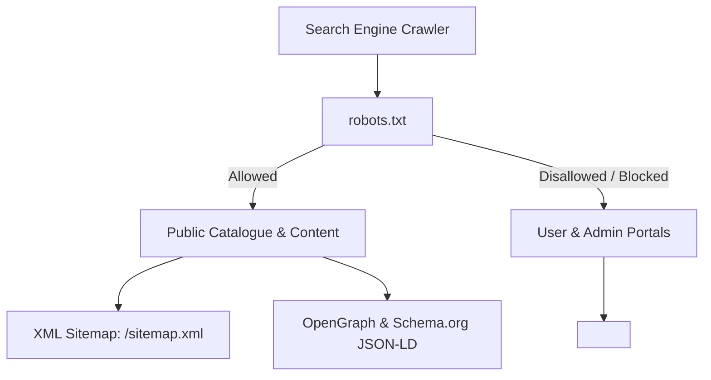

# MasterJiEstates — Non-Functional Requirements Document (NFR)

---

## 1. System Performance & Quality of Service (QoS)

### 1.1 Web Vitals & Frontend Benchmarks
The user interface must adhere to Google Core Web Vitals benchmarks across mobile (4G throttled) and desktop environments:

| Metric | Target Threshold | Architecture Strategy |
| :--- | :--- | :--- |
| **Largest Contentful Paint (LCP)** | $\le 2.2\text{ s}$ | Cloudinary WebP/AVIF transformation, image `fetchpriority="high"`, pre-connecting to image CDN, font preloading. |
| **Interaction to Next Paint (INP)** | $\le 150\text{ ms}$ | Debounced inputs (300ms) on search/filter, virtualization for large lists, zero blocking heavy main-thread computations. |
| **Cumulative Layout Shift (CLS)** | $\le 0.05$ | Explicit aspect-ratio reservations on image placeholders, skeleton loaders for async property cards. |
| **First Contentful Paint (FCP)** | $\le 1.2\text{ s}$ | Minified bundle splitting, tree-shaking MUI components, modern CSS via Tailwind JIT. |

### 1.2 API & Server Performance
- **p95 API Response Time:** $\le 200\text{ ms}$ for read endpoints; $\le 400\text{ ms}$ for search endpoints with compound filtering.
- **Throughput Capacity:** Support up to 50 concurrent active users and 300 requests/second without CPU saturation on base production tier.
- **Database Connection Pooling:** Mongoose configured with a pool size between 10 and 50 connections to eliminate connection handshake overhead.

---

## 2. Scalability Architecture

```
                       ┌────────────────────────┐
                       │ Cloudflare Edge / CDN  │
                       │ (Static Assets & HTML) │
                       └───────────┬────────────┘
                                   │
              ┌────────────────────┴────────────────────┐
              ▼                                         ▼
   ┌──────────────────────┐                  ┌──────────────────────┐
   │ Client SPA App       │                  │ Express REST API     │
   │ (Cloudflare Pages)   │                  │ (Stateless on Render)│
   └──────────────────────┘                  └──────────┬───────────┘
                                                        │
                                   ┌────────────────────┴────────────────────┐
                                   ▼                                         ▼
                        ┌─────────────────────┐                   ┌─────────────────────┐
                        │ MongoDB Atlas (M10) │                   │ Cloudinary Media CDN│
                        │ Primary / Replicas  │                   │ Global Optimization │
                        └─────────────────────┘                   └─────────────────────┘
```

1. **Stateless API Services:** The Express.js backend stores no local session state in memory. All authentication relies on signed JWTs verified statelessly, enabling trivial horizontal scaling behind load balancers.
2. **Database Read Optimization:** 
   - Strict indexing across all filterable attributes (`status`, `category`, `city`, `price`).
   - Lean query projection (`.select('-internalNotes -ownerId')`) to minimize memory allocation and network payload size.
3. **Asset Offloading:** Zero local file storage on the Node.js application server. All property imagery is streamed directly or uploaded via signed presets to Cloudinary.

---

## 3. Security & Compliance Architecture

### 3.1 OWASP Top 10 Mitigation Matrix

| Vulnerability Type | Threat Scenario | Architectural Mitigation |
| :--- | :--- | :--- |
| **Broken Object Level Auth (BOLA / IDOR)** | Attacker alters `:id` in `PATCH /api/v1/properties/:id` to modify another owner's property. | Ownership validation middleware (`verifyPropertyOwnership`) confirms `property.ownerId.equals(req.user._id)` before allowing mutation. |
| **Sensitive Data Exposure** | Public API leaking property owner phone number or company acquisition costs. | DTO serialization layer and Mongoose schema projection (`select: false`) guarantee private fields never leave the server. |
| **Broken Authentication** | Credential stuffing, brute force, token theft via XSS. | Bcrypt hashing with 12 salt rounds; JWT stored exclusively in `HttpOnly`, `Secure`, `SameSite=Lax` cookies; strict express-rate-limit on auth endpoints. |
| **Cross-Site Scripting (XSS)** | Malicious scripts injected into property descriptions or enquiry messages. | React's automatic JSX string escaping; sanitize-html middleware on all rich-text input fields; Content Security Policy (CSP) headers via Helmet. |
| **Cross-Site Request Forgery (CSRF)** | Unauthorized state mutations triggered from third-party sites using browser cookies. | Strict `SameSite=Lax` cookie configuration; custom `X-Requested-With` header verification on API mutations. |
| **Denial of Service (DoS)** | Automated bot spamming enquiry submissions or heavy search queries. | Rate limiting: Global API (100 req/min/IP), Enquiries (5 req/hour/IP), Auth attempts (5 failed attempts/15 min/IP). |

### 3.2 Secure Header Configuration (Helmet)
```javascript
// Helmet security configuration
helmet({
  contentSecurityPolicy: {
    directives: {
      defaultSrc: ["'self'"],
      scriptSrc: ["'self'", "https://apis.google.com"],
      styleSrc: ["'self'", "'unsafe-inline'", "https://fonts.googleapis.com"],
      imgSrc: ["'self'", "data:", "https://res.cloudinary.com"],
      connectSrc: ["'self'", "https://api.masterjiestates.in"]
    }
  },
  crossOriginEmbedderPolicy: false,
  hsts: { maxAge: 31536000, includeSubDomains: true, preload: true }
});
```

---

## 4. Availability, Reliability & Disaster Recovery

1. **Uptime SLA:** Target 99.9% uptime during business operating hours (8:00 AM – 10:00 PM IST).
2. **Automated Database Backups:** MongoDB Atlas continuous cloud backups with point-in-time recovery (PITR) up to 7 days.
3. **Graceful Process Handling:**
   - Node.js catches `unhandledRejection` and `uncaughtException`, logs error stack to standard error, and performs graceful server shutdown (`server.close()`).
   - Process manager (Render health checks) automatically restarts stalled or failed instances.
4. **Health Check Probes:** `/api/v1/health` endpoint returning database connectivity status, memory utilization, and service timestamp.

---

## 5. Accessibility & Usability (WCAG 2.1 AA)

1. **Color Contrast:** Deep Navy (`#0A192F`) on white achieves a contrast ratio of $14.5:1$ (exceeding the $4.5:1$ requirement for normal text). Accent Gold (`#C5A059`) text is restricted to large headers or dark navy backgrounds.
2. **Keyboard Navigability:** All interactive components (search dropdowns, modals, filter tags, pagination) support full `Tab`, `Shift+Tab`, `Enter`, and `Escape` navigation.
3. **Screen Readers:** ARIA attributes (`aria-expanded`, `aria-label`, `aria-modal`, `role="dialog"`) implemented across all drawer filters and property modals.
4. **Responsive Breakpoints:**
   - Mobile: `< 640px` (single column cards, bottom navigation drawer)
   - Tablet: `640px - 1024px` (dual column cards, collapsible filter drawer)
   - Desktop: `> 1024px` (three column grid, persistent left-side filter panel)

---

## 6. Search Engine Optimization (SEO) & Indexing



1. **Public SEO Assets:**
   - Dynamic XML sitemap served at `https://masterjiestates.in/sitemap.xml` listing all approved, active properties.
   - Clean semantic URLs: `https://masterjiestates.in/properties/:city/:category/:slug-id`.
   - Structured JSON-LD schema on property detail pages (`"@type": "SingleFamilyResidence"` or `"RealEstateListing"`).
2. **Protected Route Shielding:**
   - `robots.txt` explicitly disallows `/admin/*`, `/dashboard/*`, `/api/*`, `/login`, `/register`.
   - All authenticated routes inject `<meta name="robots" content="noindex, nofollow" />`.

---

## 7. Auditability, Logging & Monitoring

1. **Operational Audit Logs:** Every critical state transition (property approval, price modification, deal closing, user suspension) logs an immutable event into the `auditLogs` collection containing:
   - `actorId` (Admin / User ID)
   - `action` (`PROPERTY_APPROVED`, `PRICE_UPDATED`, etc.)
   - `targetCollection` & `targetId`
   - `ipAddress` & `userAgent`
   - `timestamp`
2. **Error Logging:** Centralized logging with winston or pino capturing request IDs, stack traces, and request context without logging user passwords or payment details.

