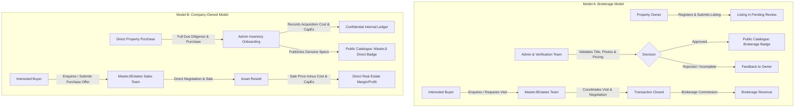

# MasterJiEstates — Project Overview & Strategic Architecture

---

## 1. Executive Summary

**MasterJiEstates** (`https://masterjiestates.in`) is an enterprise-grade digital real estate platform engineered to modernize property discovery, brokerage transactions, and proprietary real estate portfolio management in the Indian market. Unlike rudimentary property listing classifieds that merely display raw contact numbers and foster unverified listings, MasterJiEstates functions as a full-service, business-driven real estate ecosystem. 

The platform bridges property buyers, property owners, and internal real estate operators through an integrated workflow encompassing verified property onboarding, mediated brokerage transactions, private company-owned property acquisitions and sales, site visit scheduling, lead management, and transaction ledger tracking.

---

## 2. Platform Vision, Mission & Core Values

### 2.1 Vision
To establish MasterJiEstates as the definitive, trusted benchmark for transparent, high-integrity real estate transactions, eliminating friction, spam, and unverified listings through rigorous verification and end-to-end transaction facilitation.

### 2.2 Mission
- Provide property buyers with a curated, transparent catalogue of legally vetted and physically verified properties.
- Enable property owners to monetize their assets without exposing their personal identities and contact numbers to unsolicited calls and market spam.
- Empower MasterJiEstates internal operations with professional-grade digital tools to manage brokerage pipelines, company-owned real estate inventory, commission settlements, and client relationships.

### 2.3 Core Operating Principles
1. **Zero Public PII Exposure:** Property owner personal contact details (names, phone numbers, identity credentials) are strictly confidential and never exposed via client interfaces or public APIs.
2. **Dual-Model Transparency:** Clear, unambiguous distinction between brokerage-mediated listings and company-owned real estate inventory.
3. **End-to-End Mediation:** MasterJiEstates acts as the central facilitator for property enquiries, negotiations, physical site visits, and legal transaction coordination.
4. **Data Integrity & Legal Due Diligence:** Properties must undergo administrative verification before public catalog inclusion.

---

## 3. Dual Business Model Architecture

### 3.1 Model A: Brokerage Property Model
- **Stakeholders:** Property Owner (Seller/Landlord), Prospective Buyer/Tenant, MasterJiEstates (Broker/Mediator).
- **Listing Source:** External registered owners submit listing applications via the multi-step seller portal.
- **Verification Workflow:** Listings remain in `pending_review` until an administrator physically or documentarily verifies the property's availability, legitimate ownership, and valuation.
- **Public Presentation:** Displayed with the official MasterJiEstates contact helpline and enquiry forms. Owner details are completely masked.
- **Monetization:** Standardized percentage or milestone-based brokerage commission paid to MasterJiEstates upon successful execution of the registered sale/lease deed.

### 3.2 Model B: Company-Owned Inventory Model
- **Stakeholders:** MasterJiEstates (Direct Owner/Seller), Prospective Buyer.
- **Listing Source:** MasterJiEstates independently acquires land, residential units, or commercial properties as company assets.
- **Inventory Workflow:** Admin creates a `company_owned` asset record, logging the purchase price, legal fees, renovation/staging capital expenditure (CapEx), and target selling price.
- **Public Presentation:** Displayed with a prominent "MasterJi Direct / Company-Owned" badge, reassuring buyers of clear titles, immediate possession readiness, and direct deal execution without intermediary brokerage fees.
- **Monetization:** Full capital appreciation and trading margin (Selling Price minus Acquisition & Improvement Costs).
- **Confidentiality Rule:** Internal purchase price, renovation expenses, carrying costs, and profit calculations are strictly confined to administrative ledgers and never leaked to public endpoints or client state.

---

## 4. System Scope & Boundaries

| In-Scope Capabilities | Out-of-Scope (Boundaries for Initial Phases) |
| :--- | :--- |
| Responsive web portal (Desktop, Tablet, Mobile) | Native iOS/Android mobile apps (Planned for post-launch) |
| Unified buyer/seller account architecture | Automated payment gateway for full property purchasing (Real estate transactions require statutory legal registry) |
| Category-specific dynamic attribute validation | Direct owner-to-buyer peer-to-peer open chat (Bypasses brokerage mediation and leaks PII) |
| Multi-status property lifecycle management | Algorithmic automated property valuation (AVM) |
| Private administrative financial & commission ledger | Public display of raw land titles or owner government IDs |
| Cloudinary-based multi-resolution media management | High-volume microservices infrastructure (Monolithic Express architecture prioritized for maintainability) |
| Role-based access control (Visitor, User, Admin) | Direct programmatic integration with bank core systems for loan approval |

---

## 5. Architectural Principles

1. **Decoupled Architecture:** Clean separation of concerns between the presentation tier (React Single Page Application) and the application/persistence tier (Node.js/Express REST API with MongoDB Atlas).
2. **Defense-in-Depth Security:** Every API endpoint independently authenticates requests, enforces RBAC, validates request payloads, and strips confidential fields before returning responses.
3. **Zero Trust State Management:** Client-side flags (`isAdmin = true`) are treated purely as UI convenience helpers; all authorizations and mutations are strictly verified by backend JWT token validation and database lookups.
4. **Performance & Lightweight Aesthetics:** Modern UI utilizing a tailored Neumorphic design for dashboards, Liquid Glass accents for modal dialogues, and GSAP for fluid micro-interactions, avoiding heavy 3D frameworks or unoptimized libraries.
5. **SEO First for Public Surfaces:** Semantic HTML5, structured JSON-LD real estate metadata, canonical URL conventions, and dynamic sitemaps for maximum search engine indexation, while strictly barricading authenticated dashboards with `noindex, nofollow` and `robots.txt`.

---

## 6. Target Audience & Market Positioning

MasterJiEstates is tailored for the Indian real estate market, addressing traditional pain points:
- **For Buyers:** Overcoming fear of fraudulent listings, phantom inventory, deceptive pricing, and aggressive unsolicited telemarketing. MasterJiEstates offers verified inventory, transparent specifications, and structured site visits.
- **For Sellers:** Overcoming the chaos of listing on open classifieds where phone numbers are harvested by hundreds of unsolicited brokers. MasterJiEstates provides professional representation and vetted buyer leads.
- **For Investors:** Access to high-growth residential plots, commercial spaces, and pre-vetted company-owned properties with clear legal titles.

---

## 7. 15-Part Development Phasing Roadmap

| Phase | Milestone Name | Primary Focus |
| :---: | :--- | :--- |
| **Part 1** | **Project Architecture & Planning** *(Current)* | Complete requirements, business models, schemas, API contracts, security blueprints & documentation. |
| **Part 2** | **Project Setup** | Workspace initialization, frontend/backend directory setup, Git configurations, tooling & environment templates. |
| **Part 3** | **Global UI/UX Design System** | Tailwind theme tokens, MUI theme harmony, Neumorphic surfaces, Liquid Glass modals, typography & icons. |
| **Part 4** | **Login & Registration** | Split-screen authentication layouts, form validation, password visibility toggles, mock/live auth states. |
| **Part 5** | **Homepage** | High-impact hero section, multi-parameter search bar, featured property carousel, services overview, testimonials & footer. |
| **Part 6** | **Property Catalogue** | Faceted filter sidebar, category filters, price range sliders, grid/list view switcher, sorting & pagination. |
| **Part 7** | **Property Details & Enquiry** | Image gallery, property attributes, amenities grid, location overview, enquiry form & site visit modal. |
| **Part 8** | **Backend & Database** | Node.js/Express scaffolding, MongoDB Atlas connection, Mongoose model definitions & seed data scripts. |
| **Part 9** | **Authentication & Security** | bcrypt password hashing, JWT issue/verify, HTTP-only secure cookie sessions, CORS, rate limiting & error middleware. |
| **Part 10** | **User Dashboard** | Unified dashboard, saved favorites, submitted enquiries tracker, site visit manager & user profile settings. |
| **Part 11** | **Property Submission System** | Multi-step seller wizard, category-specific fields, Cloudinary photo uploads & submission status tracking. |
| **Part 12** | **Admin Dashboard** | Property moderation queue, approval/rejection modal, user directory, content CMS & enquiry management. |
| **Part 13** | **Business Operations** | Brokerage commission ledger, company-owned inventory purchase/expense tracker, deal pipeline & business analytics. |
| **Part 14** | **Additional Services & Company Pages** | About Us, Service detail pages (Home loans, Architecture, Interiors), Contact Us & statutory Legal pages. |
| **Part 15** | **Testing & Deployment** | End-to-end audit, cross-browser validation, performance profiling, Cloudflare Pages + Render configuration & deployment runbook. |

