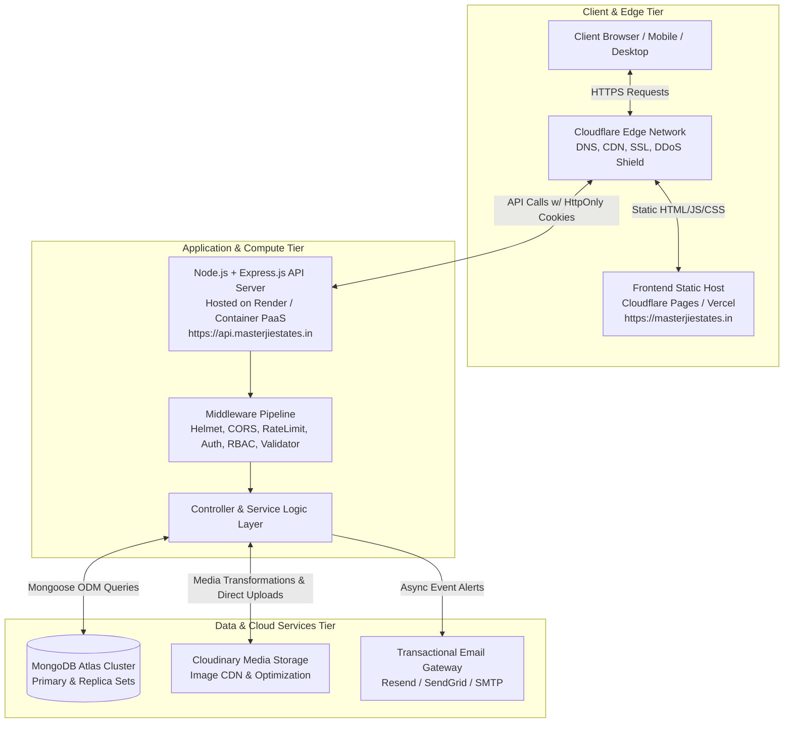
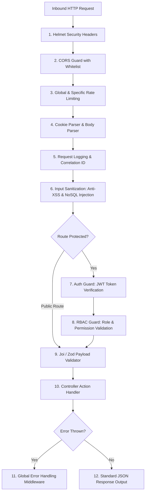

# MasterJiEstates — System Architecture & Infrastructure Blueprint

---

## 1. High-Level System Architecture

MasterJiEstates is architected as a modular, decoupled web system comprising a React-based single-page application (SPA) presentation tier and an Express.js RESTful API service tier, backed by MongoDB Atlas and Cloudinary media infrastructure.



---

## 2. Technology Stack & Tier Responsibilities

### 2.1 Presentation Tier (Frontend)
- **Core Library:** React.js (v18+) with functional components and React Hooks.
- **Language:** Modern JavaScript (ES6+).
- **Styling Framework:** Tailwind CSS for foundational grid, responsive typography, spacing utilities, and custom Neumorphic surface utilities.
- **Component System:** Material UI (MUI v5) utilized selectively for complex, accessible interface widgets (DataGrid for administrative tables, DatePickers for visit scheduling, Select menus, and Dialog wrappers).
- **Animation Engine:** GSAP (GreenSock Animation Platform) for selective high-impact micro-animations (hero typography entrance, scroll-triggered card reveals, smooth dashboard tab transitions).
- **Client Routing:** React Router v6 with declarative nested route trees, auth route guards (`<ProtectedRoute role="user" />`, `<AdminRoute />`), and automatic scroll restoration.
- **State Management:** Native React Context (`AuthContext`, `PropertyFilterContext`, `NotificationContext`) avoiding unnecessary Redux boilerplate.

### 2.2 Application Tier (Backend)
- **Runtime:** Node.js (v20+ LTS).
- **Framework:** Express.js (v4.x/5.x) configured as a stateless REST API.
- **Session & Token Management:** JSON Web Tokens (JWT) signed with HMAC-SHA256, transmitted exclusively through `HttpOnly`, `Secure`, `SameSite=Lax` browser cookies.
- **Password Cryptography:** bcrypt with 12 salt rounds.
- **Data Validation:** Joi / Zod schema validation applied before any request reaches business controllers.

### 2.3 Persistence & Asset Tier (Database & Storage)
- **Database:** MongoDB Atlas (Cloud-hosted NoSQL) utilizing Mongoose ODM for schema typing, validation hooks, compound indexes, and relationship population.
- **Media Asset Infrastructure:** Cloudinary for storage, automated WebP/AVIF transcoding, responsive resizing, and automated security watermarking ("MasterJiEstates Verified").

---

## 3. Decoupled Subdomain Architecture & Cross-Origin Strategy

The platform operates across two designated subdomains under the official acquired domain:
- **Client Web Application:** `https://masterjiestates.in` (and `https://www.masterjiestates.in`)
- **Backend API Gateway:** `https://api.masterjiestates.in`

```mermaid
sequenceDiagram
    autonumber
    actor Browser as User Browser (masterjiestates.in)
    participant Edge as Cloudflare SSL Edge
    participant API as Express API (api.masterjiestates.in)
    participant DB as MongoDB Atlas

    Browser->>API: POST /api/v1/auth/login (Credentials)
    API->>DB: Validate user & verify bcrypt hash
    DB-->>API: User record matches
    API-->>Browser: 200 OK + Set-Cookie: mje_token=JWT; Domain=.masterjiestates.in; HttpOnly; Secure; SameSite=Lax
    
    Note over Browser,API: Subsequent Authenticated Request
    Browser->>API: GET /api/v1/user/properties (Cookie auto-attached)
    API->>API: Verify JWT signature & extract req.user
    API->>DB: Query properties where ownerId == req.user.id
    DB-->>API: Return owned properties
    API-->>Browser: 200 OK + JSON DTO
```

### 3.1 Cross-Origin Resource Sharing (CORS) Configuration
To ensure secure credential sharing between `masterjiestates.in` and `api.masterjiestates.in`, CORS is strictly locked down:
```javascript
const allowedOrigins = [
  'https://masterjiestates.in',
  'https://www.masterjiestates.in',
  'http://localhost:5173', // Local Vite development
  'http://localhost:3000'
];

app.use(cors({
  origin: (origin, callback) => {
    if (!origin || allowedOrigins.includes(origin)) {
      callback(null, true);
    } else {
      callback(new Error('Blocked by Cross-Origin Resource Sharing (CORS) policy'));
    }
  },
  credentials: true, // Crucial for receiving and setting HttpOnly cookies
  methods: ['GET', 'POST', 'PUT', 'PATCH', 'DELETE', 'OPTIONS'],
  allowedHeaders: ['Content-Type', 'Authorization', 'X-Requested-With']
}));
```

### 3.2 Cookie Domain Scoping
When deploying across subdomains, the session cookie is scoped to the shared parent domain:
```javascript
res.cookie('mje_token', token, {
  httpOnly: true,
  secure: process.env.NODE_ENV === 'production', // true in production (HTTPS)
  sameSite: 'lax',
  domain: process.env.NODE_ENV === 'production' ? '.masterjiestates.in' : undefined,
  maxAge: 7 * 24 * 60 * 60 * 1000 // 7 days
});
```

---

## 4. Middleware Execution Pipeline

Every inbound HTTP request to `api.masterjiestates.in` passes through a deterministic security and processing pipeline:



### Key Middleware Definitions:
1. **Security Headers (Helmet):** Enforces HSTS, X-Content-Type-Options, Frameguard (`DENY`), and CSP.
2. **Rate Limiting:** Protects auth endpoints against credential stuffing and prevents enquiry spam.
3. **Data Sanitization:** Express `express-mongo-sanitize` strips `$` and `.` operators to eliminate NoSQL injection risks.
4. **JWT Authentication Guard (`authenticate`):** Reads `req.cookies.mje_token`, verifies signature with `JWT_SECRET`, queries user existence, and decorates `req.user`.
5. **Role-Based Guard (`authorize('admin')`):** Verifies if `req.user.role` fulfills required privilege level.
6. **Centralized Error Handler:** Intercepts uncaught exceptions, operational errors, and Mongoose validation errors, returning structured, user-friendly JSON without exposing internal server stack traces in production.

---

## 5. Media Upload & Processing Pipeline

Property photography is vital to real estate conversions. High-resolution imagery is handled securely without overloading server bandwidth:

```mermaid
sequenceDiagram
    autonumber
    actor Client as User / Admin Browser
    participant API as Express API Server
    participant Cloudinary as Cloudinary Cloud Storage

    Client->>API: POST /api/v1/media/signed-url (Request upload signature)
    API->>API: Verify auth & role; generate HMAC SHA-1 signature
    API-->>Client: Return { signature, timestamp, apiKey, folder, eagerTransforms }
    
    Client->>Cloudinary: POST https://api.cloudinary.com/v1_1/mj-estates/image/upload
    Note over Client,Cloudinary: Client uploads direct to Cloudinary CDN
    Cloudinary->>Cloudinary: Auto WebP/AVIF conversion, scale, watermark
    Cloudinary-->>Client: 200 OK + { public_id, secure_url, width, height }
    
    Client->>API: POST /api/v1/user/properties (Submits form with Cloudinary URLs)
    API->>API: Validate URL pattern & save property record
```

---

## 6. System Resiliency & Error Handling Strategy

1. **Standardized Response Envelope:**
   All API endpoints output a predictable response schema:
   ```json
   {
     "success": true,
     "statusCode": 200,
     "message": "Resource retrieved successfully",
     "data": {},
     "meta": { "total": 100, "page": 1, "limit": 12 }
   }
   ```
2. **Predictable Error Formatting:**
   ```json
   {
     "success": false,
     "statusCode": 404,
     "message": "The requested property was not found or is no longer available",
     "errors": []
   }
   ```
3. **Health Check Probe:**
   `GET /api/v1/health` returns:
   ```json
   {
     "status": "healthy",
     "uptime": 128420,
     "timestamp": "2026-11-07T10:00:00.000Z",
     "services": {
       "database": "connected",
       "mediaCDN": "ready"
     }
   }
   ```

