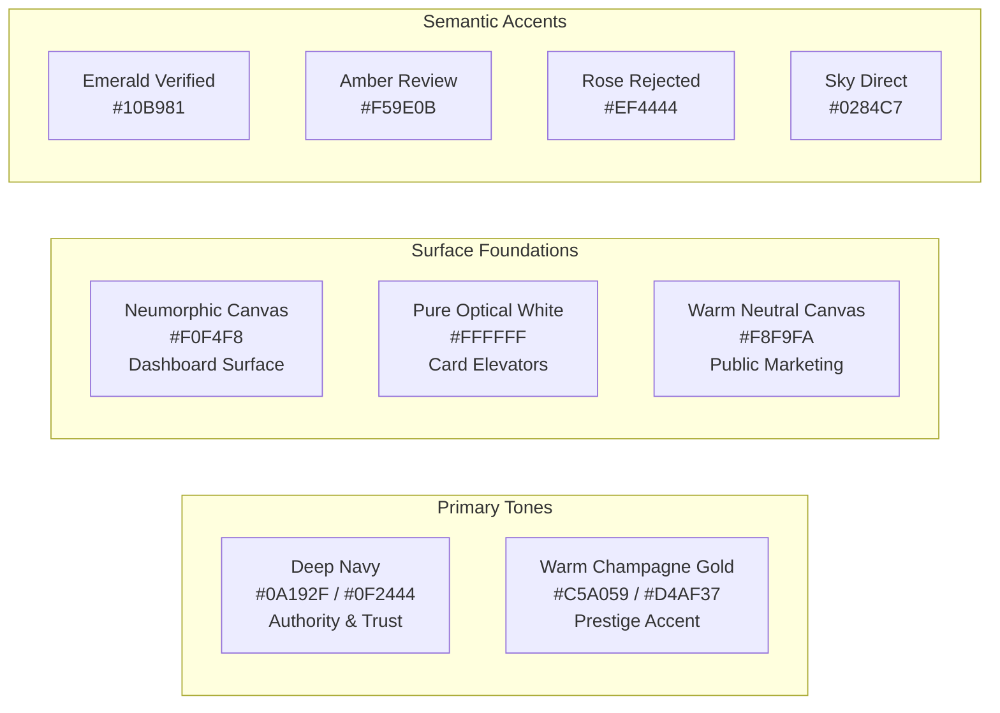

# MasterJiEstates — UI/UX Design System & Visual Architecture

---

## 1. Brand Identity & Design Ethos

**MasterJiEstates** embodies trust, architectural permanence, and sophisticated minimalism. The visual design establishes the platform not merely as a commercial aggregator, but as a prestigious real estate advisory institution.

- **Brand Name:** MasterJiEstates
- **Official Domain:** `https://masterjiestates.in`
- **Official Tagline:** *"MasterJiEstates — From Finding Your Property to Building Your Dream."*
- **Primary Design Principle:** Clean, authoritative, spacious, and tactile. High signal-to-noise ratio where property imagery and structured specifications take center stage.

---

## 2. Color Palette & Design Tokens



### 2.1 Color Token Table

| Token Name | Hex Code | Tailwind Class Equivalent | Semantic Usage |
| :--- | :--- | :--- | :--- |
| `brand-navy-dark` | `#0A192F` | `bg-slate-950` / Custom | Primary navigation, dark headers, high-contrast headings. |
| `brand-navy-primary` | `#0F2444` | Custom `navy-900` | Primary buttons, active sidebar selection, brand hero accents. |
| `brand-navy-light` | `#1B3B6F` | Custom `navy-700` | Hover states for primary elements, subtle borders. |
| `brand-gold-primary` | `#C5A059` | Custom `gold-500` | Accent badges, star ratings, CTA borders, luxury highlights. |
| `brand-gold-light` | `#F4E8C1` | Custom `gold-100` | Soft pill backgrounds, VIP badges, highlight fills. |
| `surface-canvas` | `#F0F4F8` | Custom `slate-100` | Neumorphic dashboard background and app canvas. |
| `surface-card` | `#FFFFFF` | `bg-white` | Elevated property cards, modal containers, data tables. |
| `text-primary` | `#0F172A` | `text-slate-900` | Body headlines, titles, primary specifications. |
| `text-secondary` | `#64748B` | `text-slate-500` | Subtitles, helper text, timestamps, labels. |
| `status-verified` | `#10B981` | `text-emerald-500` | Approved badge, verified owner, successful deal. |
| `status-pending` | `#F59E0B` | `text-amber-500` | Under review badge, pending site visit. |
| `status-direct` | `#0284C7` | `text-sky-600` | MasterJi Direct / Company-Owned badge. |

---

## 3. Visual Experience Architecture

### 3.1 Login & Registration: Split-Screen Architectural Layout
Inspired by modern high-end architectural portals, authentication screens feature a dedicated 50/50 split layout on desktop screens:
- **Left Panel (Authentication Form - 50% Width):**
  - Crisp, uncluttered pure white canvas (`#FFFFFF`).
  - MasterJiEstates logo with navy and subtle gold emblem at top left.
  - Large typography: *"Welcome to MasterJiEstates"* with subtitle *"Discover, acquire, and manage premium properties."*
  - Floating labeled input fields (Email Address, Password with interactive eye show/hide toggle).
  - Auxiliary controls: "Remember this device" checkbox and "Forgot Password?" link.
  - Primary CTA button in Deep Navy (`#0F2444`) with subtle gold hover glow.
  - Switch account pathway: *"Don't have an account? Create one."*
- **Right Panel (Curated Visual Showcase - 50% Width):**
  - High-resolution architectural photograph (modern luxury residence / iconic urban skyline).
  - Subtle dark navy gradient vignette (`from-navy-900/60 to-navy-950/90`) ensuring text readability.
  - Inset testimonial / brand quote: *"From Finding Your Property to Building Your Dream."*

```
┌──────────────────────────────────────┬──────────────────────────────────────┐
│  MasterJiEstates                     │                                      │
│                                      │     [ High-Resolution Luxury         │
│  Sign in to your account             │       Architectural Visual ]         │
│                                      │                                      │
│  [ Email Address                  ]  │                                      │
│  [ Password                 (eye) ]  │                                      │
│                                      │   "From Finding Your Property        │
│  [x] Remember me    Forgot Password? │    to Building Your Dream."          │
│                                      │                                      │
│  [       Sign In Button           ]  │     - MasterJiEstates Advisory       │
│                                      │                                      │
│  Don't have an account? Sign up      │                                      │
└──────────────────────────────────────┴──────────────────────────────────────┘
```

---

### 3.2 User & Admin Dashboards: Light Neumorphic Architecture
The dashboard employs a refined, light Neumorphic surface style, delivering tactile depth without sacrificing speed or clarity:
- **Canvas Foundation:** Pale sky-blue/gray background (`#F0F4F8`).
- **Neumorphic Card Shadows:** Dual opposing soft shadows creating an organic embossed elevation:
  ```css
  /* Neumorphic Flat Surface */
  .neumorphic-card {
    background: #F0F4F8;
    box-shadow: 8px 8px 18px #d1d9e6, -8px -8px 18px #ffffff;
    border-radius: 20px;
    border: 1px solid rgba(255, 255, 255, 0.6);
  }

  /* Neumorphic Inset (Search bars / Active states) */
  .neumorphic-inset {
    background: #F0F4F8;
    box-shadow: inset 4px 4px 8px #d1d9e6, inset -4px -4px 8px #ffffff;
    border-radius: 12px;
  }
  ```
- **Left Navigation Sidebar:**
  - Compact, rounded icon tiles (Overview, My Properties, Favourites, Enquiries, Site Visits, Profile).
  - Active tab highlighted with Deep Navy fill and white typography.
- **Readable Data Presentation:** Inside card containers, critical tables and metrics utilize flat, high-contrast white surfaces (`#FFFFFF`) with crisp borders to ensure maximum legibility for financial numbers and property listings.

---

### 3.3 Liquid Glass Overlay Styling
Used selectively for modals, sticky floating search bars, and toast notifications to deliver contemporary depth without visual clutter:
```css
.liquid-glass {
  background: rgba(255, 255, 255, 0.75);
  backdrop-filter: blur(14px);
  -webkit-backdrop-filter: blur(14px);
  border: 1px solid rgba(255, 255, 255, 0.4);
  box-shadow: 0 8px 32px 0 rgba(15, 36, 68, 0.08);
}
```

---

## 4. Typography & Layout Hierarchy

- **Primary Font Family:** Inter / Plus Jakarta Sans (Clean, modern geometric sans-serif).
- **Secondary Accent Font (Luxury Headings):** Playfair Display / Cinzel (Utilized exclusively for luxury hero titles and premium brand statements).

| Scale Level | Size | Weight | Line Height | Usage |
| :--- | :---: | :---: | :---: | :--- |
| **Hero Title (Display 1)** | 48px / 3rem | 700 (Bold) | 1.15 | Homepage hero banner headline |
| **Section Title (Heading 1)**| 32px / 2rem | 600 (Semi-Bold) | 1.25 | Catalogue headers, page titles |
| **Card Title (Heading 2)** | 20px / 1.25rem | 600 (Semi-Bold) | 1.35 | Property card title, modal titles |
| **Sub-heading** | 16px / 1rem | 500 (Medium) | 1.4 | Property price, key metric callouts |
| **Body Regular** | 14px / 0.875rem | 400 (Regular) | 1.5 | General descriptions, table data |
| **Caption / Badge** | 12px / 0.75rem | 600 (Semi-Bold) | 1.4 | Badges, tags, timestamp labels |

---

## 5. Tailwind CSS & Material UI (MUI) Coexistence Strategy

To prevent CSS specificity conflicts and ensure optimal bundle performance, Tailwind CSS and Material UI are harmonized through a strict division of responsibilities:

1. **Role Division:**
   - **Tailwind CSS:** Primary engine for layout, grid systems, flex containers, spacing (`p-*`, `m-*`), typography utilities, Neumorphic shadows, and custom animations.
   - **Material UI (MUI):** Utilized exclusively for complex headless or accessible interactive widgets:
     - `DataGrid` for complex administrative tables (sorting, column toggles, export).
     - `DatePicker` / `TimePicker` for site visit scheduling.
     - `Slider` for two-handle budget range selection.
     - `Menu` / `Popover` for accessible contextual menus.
2. **Style Bleed Prevention Configuration:**
   - MUI is configured with `ScopedCssBaseline` or styled using the emotion cache configured to prepend MUI styles, ensuring Tailwind classes take precedence when needed:
   ```javascript
   // Emotion Cache Configuration
   import createCache from '@emotion/cache';
   export const muiCache = createCache({
     key: 'mui',
     prepend: true // Ensures Tailwind overrides MUI defaults cleanly
   });
   ```

---

## 6. Motion & GSAP Animation Principles

Motion is applied purposefully to guide user attention and convey architectural stability:
- **Hero Stagger Entrance:** Page load triggers a staggered GSAP fade-up on the hero title, search bar, and quick filter chips (duration: 0.8s, ease: `power2.out`).
- **Scroll-Triggered Card Reveal:** Property cards in the catalogue reveal gracefully as they enter the viewport (`y: 30, opacity: 0, duration: 0.5`).
- **Micro-Interactions:** Hover states on property cards feature a subtle elevation lift (`translate-y: -4px`) and image zoom (`scale: 1.04`), with smooth CSS transitions (`duration-300`).
- **Heavy 3D Restrictions:** Three.js, unoptimized WebGL, and heavy looping canvas effects are strictly prohibited to maintain mobile battery efficiency and fast Core Web Vitals.

