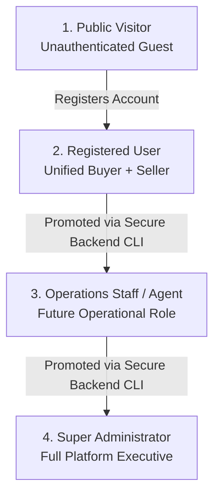
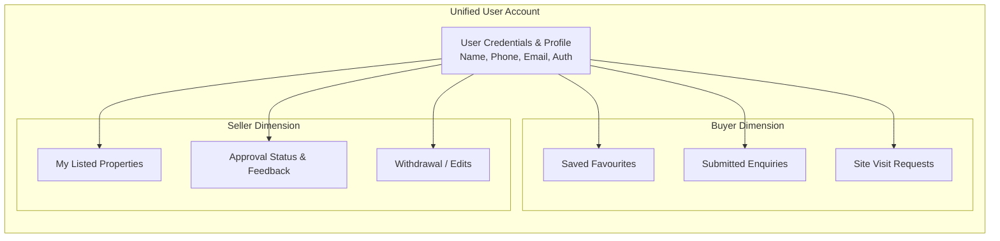

# MasterJiEstates — User Roles & Permissions Architecture

---

## 1. Role Hierarchy & Persona Taxonomy

MasterJiEstates implements a strict Role-Based Access Control (RBAC) model augmented by Attribute-Based Access Control (ABAC) for object-level resource ownership.



### 1.1 Defined Roles

| Role Identifier | Description & Responsibility | Elevation Pathway |
| :--- | :--- | :--- |
| `visitor` | Anonymous public guest. Can view approved properties, public company info, and submit lead forms. | Self-registration via `/register`. |
| `user` | Authenticated citizen account. Holds simultaneous Buyer and Seller privileges. Can favorite, enquire, schedule visits, and submit properties. | Default role assigned upon registration. |
| `staff` *(Future)* | MasterJiEstates field agent or customer service rep. Can view assigned leads, log site visit notes, and view brokerage listings without financial access. | Provisioned exclusively by Super Admin via backend CLI. |
| `admin` | Super Administrator. Unrestricted access to moderation queues, financial ledgers (company purchase costs, CapEx, commissions), user records, and CMS. | Provisioned strictly via secure server CLI seed script. Never via web registration. |

---

## 2. Granular RBAC Permissions Matrix

| Resource Domain | Specific Action | Public Visitor | Registered User | Staff / Agent | Super Admin | Enforcement Rule |
| :--- | :--- | :---: | :---: | :---: | :---: | :--- |
| **Properties** | View Approved Public Listings | ✅ | ✅ | ✅ | ✅ | Public endpoint (`status: 'available'`) |
| | View Property Owner Details | ❌ | ❌ | ✅ | ✅ | Controller masks owner PII unless role is Admin/Staff |
| | Submit New Listing | ❌ | ✅ | ✅ | ✅ | Created with status `pending_review` |
| | Edit Own Property | ❌ | ✅ (Own Only) | ❌ | ✅ | ABAC: `property.ownerId === req.user._id` |
| | Moderate / Approve / Reject Listings | ❌ | ❌ | ❌ | ✅ | Restricted to `admin` role |
| | View Company Acquisition Cost & CapEx | ❌ | ❌ | ❌ | ✅ | `purchases` and `expenses` collections restricted to `admin` |
| | Mark Property as Sold / Closed | ❌ | ❌ | ❌ | ✅ | Restricted to `admin` role |
| **Enquiries & Leads** | Submit Public Enquiry | ✅ | ✅ | ❌ | ❌ | Public lead form or authenticated auto-fill |
| | View Own Submitted Enquiries | ❌ | ✅ (Own Only) | ❌ | ✅ | Filtered by `enquiry.userId === req.user._id` |
| | View All Enquiries & Assign Leads | ❌ | ❌ | ✅ (Assigned) | ✅ (All) | Operations dashboard |
| | Update Enquiry Resolution Status | ❌ | ❌ | ✅ (Assigned) | ✅ | Status transition validation |
| **Site Visits** | Request Site Visit | ❌ | ✅ | ❌ | ❌ | Authenticated request with preferred time |
| | View Own Site Visits | ❌ | ✅ (Own Only) | ❌ | ✅ | Filtered by `visit.userId === req.user._id` |
| | Manage Schedule & Dispatch Field Exec | ❌ | ❌ | ✅ | ✅ | Admin / Staff scheduling tool |
| **Financials & Deals** | View Brokerage Commission Ledger | ❌ | ❌ | ❌ | ✅ | Restricted to `admin` role |
| | Record Deal & Calculate Commission | ❌ | ❌ | ❌ | ✅ | Restricted to `admin` role |
| | Record Company Property Purchase & CapEx| ❌ | ❌ | ❌ | ✅ | Restricted to `admin` role |
| **User Directory** | View Public Profile / Agent Info | ❌ | ❌ | ❌ | ❌ | No public directory exposed |
| | Manage / Suspend Registered Accounts | ❌ | ❌ | ❌ | ✅ | Restricted to `admin` role |
| | Elevate Account to Admin | ❌ | ❌ | ❌ | ❌ | CLI/Direct DB Seed script ONLY |

---

## 3. The Unified User Account Model

A critical business architectural requirement is that **users do NOT have separate accounts for buying and selling**.



### 3.1 Adaptive Dashboard Experience
The user dashboard dynamically adapts its primary layout based on the user's active intent without fragmenting permissions:
- If a user has **0 listed properties**, the dashboard prioritizes the **Buyer Hub** (Saved Favorites, Upcoming Site Visits, Active Enquiries), accompanied by an inviting "List Your Property with MasterJi" callout.
- If a user submits a property, the dashboard elevates the **Seller Hub** (Listing Status Badges, Document Verification Status, Company Feedback).
- A persistent left sidebar provides immediate access to both functional zones simultaneously.

---

## 4. Admin Security & Immunity from Privilege Escalation

### 4.1 Strict Admin Provisioning Rules
1. **Zero Registration Elevation:** The registration controller (`POST /api/v1/auth/register`) explicitly hardcodes `role: 'user'` into the Mongoose document creation call:
   ```javascript
   // Anti-escalation guarantee
   const newUser = await User.create({
     name: req.body.name,
     email: req.body.email,
     password: hashedPassword,
     phone: req.body.phone,
     role: 'user' // Hardcoded; ignores req.body.role completely
   });
   ```
2. **Zero Profile Modification Elevation:** The user update controller (`PUT /api/v1/users/profile`) uses strict property whitelisting (`name`, `phone`, `preferences`). The `role` field is completely stripped before passing to Mongoose.
3. **Headless Admin Bootstrapping:** Administrator accounts are initialized strictly through a local administrative CLI script executed on the server environment:
   ```bash
   node server/scripts/seedAdmin.js --email=admin@masterjiestates.in --secret=$MASTER_ADMIN_SEED_KEY
   ```

---

## 5. Object-Level Access Control (ABAC Enforcement)

Role checks alone are insufficient. To prevent Insecure Direct Object References (IDOR), object-level ownership checks are enforced:

### Ownership Validation Middleware Pattern:
```javascript
// Middleware: verifyPropertyOwnership.js
export const verifyPropertyOwnership = async (req, res, next) => {
  const propertyId = req.params.id;
  const property = await Property.findById(propertyId);
  
  if (!property) {
    return res.status(404).json({ success: false, message: 'Property not found' });
  }

  // Super-admin override permitted
  if (req.user.role === 'admin') {
    req.property = property;
    return next();
  }

  // Strict ownership matching for registered users
  if (!property.ownerId || !property.ownerId.equals(req.user._id)) {
    return res.status(403).json({ 
      success: false, 
      message: 'Access denied: You are not authorized to modify this property' 
    });
  }

  req.property = property;
  next();
};
```

