# MasterJiEstates — Website Sitemap & Routing Architecture

---

## 1. Global Navigation & Architecture Overview

MasterJiEstates is divided into three distinct routing zones:
1. **Public Marketing & Discovery Zone:** Fully crawlable, SEO-optimized, accessible to all visitors.
2. **Authenticated User Portal Zone (`/dashboard`):** Unified portal for buyers and sellers, protected by auth middleware.
3. **Restricted Administrative Suite (`/admin`):** Executive back-office operations, strictly guarded by server-side admin role enforcement.

```mermaid
graph TD
    ROOT[https://masterjiestates.in]
    
    subgraph 1. Public Marketing & Discovery Zone
        ROOT --> HOME[Home /]
        ROOT --> PROPS[Properties /properties]
        PROPS --> DETAIL[Property Details /properties/:city/:category/:slugId]
        ROOT --> ABOUT[About Us /about]
        ROOT --> SERV[Services /services]
        ROOT --> CONTACT[Contact Us /contact]
        ROOT --> LEGAL[Legal /privacy-policy & /terms]
        ROOT --> AUTH[Auth /login & /register]
    end

    subgraph 2. Authenticated User Zone
        AUTH -->|User Logged In| DASH[User Dashboard /dashboard]
        DASH --> DASH_FAV[My Favourites /dashboard/favourites]
        DASH --> DASH_ENQ[My Enquiries /dashboard/enquiries]
        DASH --> DASH_VIS[Site Visits /dashboard/site-visits]
        DASH --> DASH_PROP[My Properties /dashboard/properties]
        DASH --> DASH_ADD[Add Property /dashboard/properties/new]
        DASH --> DASH_PROF[Profile /dashboard/profile]
    end

    subgraph 3. Administrative Control Suite
        AUTH -->|Admin Logged In| ADM[Admin Portal /admin]
        ADM --> ADM_MET[Overview Metrics /admin]
        ADM --> ADM_APP[Moderation Queue /admin/approvals]
        ADM --> ADM_INV[Inventory & Portfolio /admin/inventory]
        ADM --> ADM_CRM[Enquiries & Leads /admin/enquiries]
        ADM --> ADM_OPS[Site Visits /admin/site-visits]
        ADM --> ADM_FIN[Deals & Commissions /admin/deals]
        ADM --> ADM_CAPEX[Company Purchases & CapEx /admin/financials]
        ADM --> ADM_USR[User Directory /admin/users]
        ADM --> ADM_CMS[Content & CMS /admin/cms]
    end
```



---

## 2. Public Zone Route Catalog (SEO-Indexed)

| Path | Page Title | Access Level | SEO Meta Purpose | Indexing Directive |
| :--- | :--- | :---: | :--- | :---: |
| `/` | MasterJiEstates — Find, Buy & Sell Verified Real Estate | Public | Brand authority, primary search entrance, value proposition. | `index, follow` |
| `/properties` | Browse Real Estate Properties in India \| MasterJiEstates | Public | Master catalogue with faceted search and filter attributes. | `index, follow` |
| `/properties/:city/:category/:slugId` | `{Title} in {Locality}, {City} \| MasterJiEstates` | Public | High-intent property landing page with Schema.org JSON-LD markup. | `index, follow` |
| `/about` | About MasterJiEstates — Real Estate Brokerage & Asset Management | Public | Corporate mission, operational integrity, team leadership, disclaimers. | `index, follow` |
| `/services` | Our Real Estate & Allied Home Services \| MasterJiEstates | Public | Overview of brokerage, advisory, home loan guidance, and architecture partners. | `index, follow` |
| `/contact` | Contact MasterJiEstates — Head Office & Support Helpline | Public | Corporate address, contact numbers, email forms, office map coordinates. | `index, follow` |
| `/privacy-policy` | Privacy Policy \| MasterJiEstates | Public | Statutory DPDP disclosure regarding data collection, cookies, and protection. | `index, follow` |
| `/terms` | Terms of Service & Brokerage Agreement \| MasterJiEstates | Public | Platform rules, listing mandates, commission liability, legal jurisdiction. | `index, follow` |
| `/login` | Sign In to Your Account \| MasterJiEstates | Public / Guest | Split-screen login interface with secure credentials input. | `noindex, follow` |
| `/register` | Create a MasterJiEstates Account \| Buy & Sell Real Estate | Public / Guest | Split-screen registration interface for new buyers and sellers. | `noindex, follow` |
| `/forgot-password` | Reset Password \| MasterJiEstates | Public / Guest | Password reset request form via email token. | `noindex, follow` |
| `/reset-password/:token`| Set New Password \| MasterJiEstates | Public / Guest | Secure token verification and password update form. | `noindex, follow` |

---

## 3. User Dashboard Zone (`/dashboard`) — Authenticated Users

*All routes in this zone require an active authenticated JWT session (`role: 'user'` or `role: 'admin'`). Indexed with `noindex, nofollow`.*

| Path | View / Component | Primary User Purpose |
| :--- | :--- | :--- |
| `/dashboard` | Dashboard Overview | Summary cards: Active enquiries, upcoming site visits, saved favourites, listing statuses. |
| `/dashboard/favourites` | Saved Properties | Grid of bookmarked listings with quick enquiry and removal actions. |
| `/dashboard/enquiries` | My Enquiries | Status tracking table for all submitted property inquiries and company feedback. |
| `/dashboard/site-visits` | Site Visits | Schedule of requested, confirmed, and completed property tours. |
| `/dashboard/properties` | My Properties | Inventory of seller-submitted properties with status badges (`draft`, `pending`, `approved`, etc.). |
| `/dashboard/properties/new`| Add Property Wizard | Multi-step property submission flow (Details -> Location -> Specs -> Photos -> Verification). |
| `/dashboard/properties/:id/edit`| Edit Property | Editing form for properties in `draft` or `rejected` status. |
| `/dashboard/notifications`| Notifications | System alerts: Approval notices, site visit schedule confirmations, price changes. |
| `/dashboard/profile` | Profile & Security | Update contact details, reset password, manage communication preferences. |

---

## 4. Admin Portal Zone (`/admin`) — Super Administrator

*All routes in this zone require an active authenticated JWT session with role `admin`. Strictly blocked by robots.txt and server-side RBAC guards.*

| Path | View / Component | Primary Administrative Purpose |
| :--- | :--- | :--- |
| `/admin` | Executive Overview | Real-time operational metrics, conversion charts, pipeline summary, pending tasks. |
| `/admin/approvals` | Moderation Queue | Review pending seller submissions; verify photos and documents; approve or reject with notes. |
| `/admin/properties` | All Properties | Master property repository with bulk status management, filtering, and detail drawers. |
| `/admin/brokerage` | Brokerage Listings | External listings under brokerage mandates; owner management and commission tracking. |
| `/admin/company-inventory`| Company Portfolio | Proprietary real estate holdings; confidential acquisition costs, CapEx logs, target margins. |
| `/admin/enquiries` | Lead CRM & Enquiries | Inbound customer lead manager; agent assignment, interaction notes, lead stages. |
| `/admin/site-visits` | Site Visit Dispatch | Field executive dispatch calendar; site visit completion logs and buyer feedback. |
| `/admin/deals` | Deal Room & Commissions | Closed transaction records; calculation and invoicing of brokerage commissions. |
| `/admin/financials` | CapEx & Expense Tracker | Itemized financial ledger for renovation, registry, and holding expenses on company assets. |
| `/admin/users` | User & Owner Directory | Registered account directory, account activity history, suspension controls. |
| `/admin/analytics` | Business Intelligence | Historical sales velocity, category popularity, geographical heatmaps, revenue charts. |
| `/admin/cms` | Website Content CMS | Edit promotional banners, testimonials, featured partners, and corporate contact data. |
| `/admin/settings` | System Settings | Platform configuration, commission default rates, system notification templates. |

---

## 5. SEO URL Standards & Slugs

1. **Semantic Slug Architecture:**
   - Format: `/properties/:city/:category/:slug-id`
   - Example: `/properties/gurugram/apartments/luxury-3bhk-golf-course-road-mj-1082`
   - Structure Breakdown:
     - `:city` = lowercase normalized city (e.g., `gurugram`, `noida`, `delhi`)
     - `:category` = lowercase category (e.g., `apartments`, `villas`, `residential-plots`)
     - `:slug-id` = human-readable title words hyphenated + unique shortcode (`mj-1082`)
2. **Canonical Link Enforcement:**
   - Every property page injects `<link rel="canonical" href="https://masterjiestates.in/properties/gurugram/apartments/luxury-3bhk-golf-course-road-mj-1082" />`.

---

## 6. Robots.txt Specification

```txt
# https://masterjiestates.in/robots.txt
User-agent: *
Allow: /
Allow: /properties
Allow: /properties/*
Allow: /about
Allow: /services
Allow: /contact
Allow: /privacy-policy
Allow: /terms

# Block private user zones and administration
Disallow: /admin/
Disallow: /admin/*
Disallow: /dashboard/
Disallow: /dashboard/*
Disallow: /api/
Disallow: /api/*
Disallow: /login
Disallow: /register
Disallow: /forgot-password
Disallow: /reset-password/*

# Sitemap Location
Sitemap: https://masterjiestates.in/sitemap.xml
```

